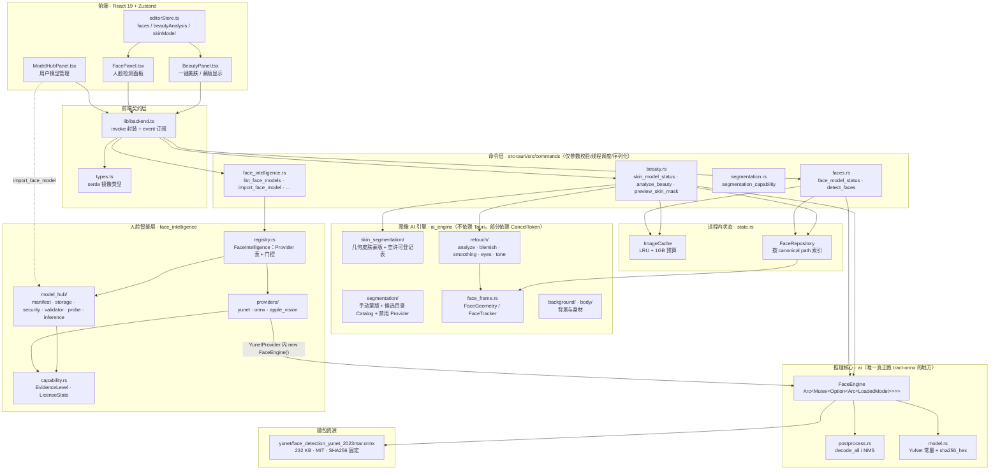
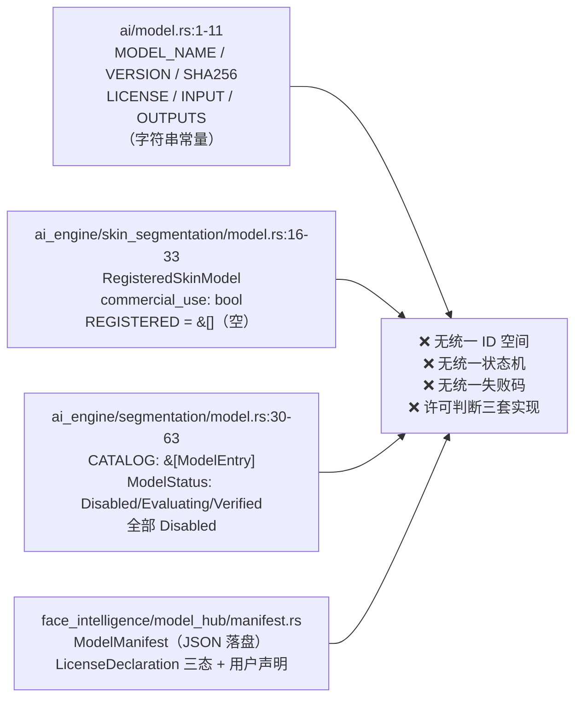
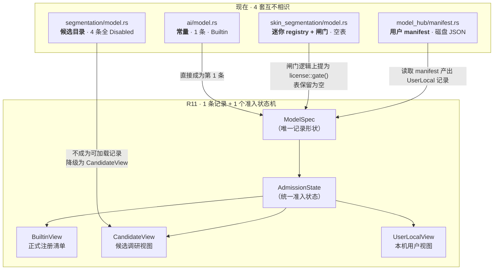
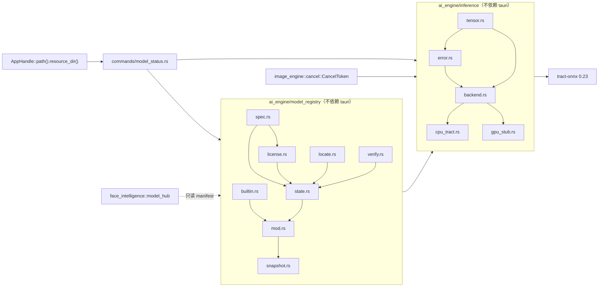
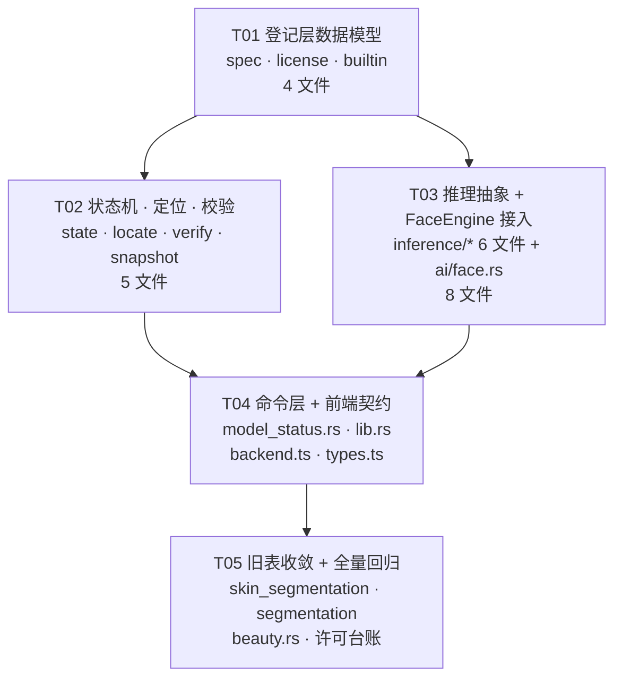

# R11 · AI 模块审计与统一模型注册 / 推理抽象设计

> 作者：高见远（Architect） · 团队 `software-lumi-r11` · 任务 #1
> 仓库：`/Users/lu/Documents/lumi人像` · 分支 `main` · HEAD `572f8f0`
> 基线采集时间：2026-11-22
> **本文件只做审计与设计，不含任何源码改动。**

---

## 0. 结论摘要（先读这一段）

1. **现状不是"没有模型注册表"，而是有四个互不相识的模型登记处**：`ai/model.rs`（YuNet 常量）、`ai_engine/skin_segmentation/model.rs`（皮肤模型 + 许可闸门）、`ai_engine/segmentation/model.rs`（候选模型目录）、`face_intelligence/model_hub/manifest.rs`（用户模型 manifest）。四者字段不重叠、无统一状态、无统一失败语义。R11 的正确做法是**新增一个权威登记层并让其余三处转发**，而不是再造第五份。**统一方案见 §2.5 + §7.5：一条 `ModelSpec` 记录 + 一个 `AdmissionState` 准入状态机，4 套元数据分别落为 `BuiltinView` / `CandidateView` / `UserLocalView`。**
2. **配套的还有两笔"分散"**：SHA-256 实现 **6 处**（其中 2 处功能等价，见 §2.4.1）、`tract_onnx` 加载点 **5 个 / 4 个文件**（见 §2.4.2）。推理抽象层必须先能覆盖这 5 种形态，才谈迁移；**本轮只迁 YuNet 那一处**。
3. **最大风险不是缺功能，而是"重复加载 + 许可判断散落 + 错误语义不可判别"**：同一张 YuNet 在进程内被 2–3 个 `FaceEngine` 实例各自 `tract` 解析一次；许可闸门只存在于皮肤模型一条路径（用户导入模型另有"用户声明"路径，与 R11 红线字面冲突，见 R14）；`AppError` 序列化成纯字符串，前端拿不到任何错误码。
4. `--no-default-features` 与默认特性**两套组合当前都 397+ 测试全绿**，AI 相关代码不依赖 `libraw`，这是本轮最有利的兼容前提。
5. **不需要新增任何依赖**。`sha2` / `thiserror` / `serde` / `tract-onnx` / `rayon` 已足够覆盖 R11 全部需求。

---

## 1. 基线

### 1.1 采集命令与结果（全部实测，2026-11-22）

| # | 命令 | 结果 | 耗时 | 说明 |
|---|------|------|------|------|
| B1 | `cargo test --lib` | **397 passed / 0 failed / 3 ignored** | 5.18s | 单元测试 |
| B2 | `cargo test`（全量） | **477 passed / 0 failed / 7 ignored** | 1m18.50s | 含 15 个 target：lib + 14 个集成测试 |
| B3 | `cargo clippy --all-targets` | **0 warning / 0 error**（`Finished dev profile in 13.01s`） | 13.01s | 无任何 clippy 输出 |
| B4 | `cargo check --no-default-features --lib` | **通过**（`Finished dev profile in 3.39s`） | 3.39s | 无 LibRaw |
| B5 | `cargo test --no-default-features --lib` | **397 passed / 0 failed / 3 ignored** | 4.93s | 与 B1 完全一致 |

### 1.2 逐 target 明细（B2 展开）

| target | passed | ignored |
|--------|--------|---------|
| `src/lib.rs` | 397 | 3 |
| `tests/beauty.rs` | 12 | 1 |
| `tests/beauty_real.rs` | 4 | 0 |
| `tests/engine.rs` | 10 | 1 |
| `tests/face_detection.rs` | 4 | 0 |
| `tests/face_intelligence.rs` | 5 | 0 |
| `tests/onnx_worker.rs` | 7 | 0 |
| `tests/raw_real.rs` | 2 | 0 |
| `tests/reshape_persistence.rs` | 3 | 0 |
| `tests/reshape_pipeline.rs` | 3 | 1 |
| `tests/round10_changeset.rs` | 11 | 0 |
| `tests/round10_performance.rs` | 5 | 0 |
| `tests/round10_real_photos.rs` | 5 | 0 |
| `tests/round8_benchmark.rs` | 0 | 1 |
| `tests/round9_1_persistence.rs` | 9 | 0 |
| **合计** | **477** | **7** |

**基线结论**：R11 的验收红线是"不回归"。任何新代码合并后必须仍满足 B2 全绿 + B3 零 warning + B4/B5 通过。`tests/beauty_real.rs` 耗时 26.96s（真实样张），是回归验证中最贵的一环，**新增的 registry 改动若触碰 `FaceEngine`，必须优先跑它**。

### 1.3 现状模型资源实测

```text
src-tauri/resources/models/yunet/
├── LICENSE                                            1,085 B
└── face_detection_yunet_2023mar.onnx                232,589 B
    sha256 = 8f2383e4dd3cfbb4553ea8718107fc0423210dc964f9f4280604804ed2552fa4  ← 与 ai/model.rs:4 一致
```

`src-tauri/tauri.conf.json:50-53` 的打包资源列表只有：

```json
"resources": [
  "resources/models/yunet/face_detection_yunet_2023mar.onnx",
  "resources/models/yunet/LICENSE",
  "resources/libraw/*"
]
```

> ⚠️ 注意：**`resources/models/skin/**` 与 `resources/models/segmentation/**` 不在打包列表内**。`skin_segmentation/model.rs:95-107` 的 `locate()` 会去找 `resources/models/skin/`，但即使放了文件也进不了安装包 —— 见风险 R8。

---

## 2. 现有 AI 架构

### 2.1 分层总图



### 2.2 逐层说明

| 层 | 职责 | 现状评价 |
|----|------|----------|
| `src/components/*` | 面板 UI。`BeautyPanel` 在挂载时查 `skinModelStatus()`，打开照片时自动 `detectFaces()`，改手动蒙版时 debounce 220ms 调 `previewSkinMask()` | 状态分散在 3 个组件 + store，模型状态有 3 份来源 |
| `src/lib/backend.ts` | 全部 `invoke` 的唯一出口，694 行 | 结构良好，是新增命令的正确落点 |
| `commands/*` | 参数校验 + `spawn_blocking` + `emit` 进度 | **异步命令都正确地进了 `spawn_blocking`**；但两个 `status` 命令是同步的（见 R1） |
| `ai_engine/*` | 纯算法：皮肤几何蒙版、磨皮、瑕疵、眼周、手动蒙版、背景、身材 | 自己的模型认知是"一张字符串常量表 + 一个空数组" |
| `ai/*` | **唯一**真正执行 `tract_onnx` 推理的地方（`ai/face.rs`） | 计划缓存做对了，但实例不唯一 |
| `face_intelligence/*` | Provider 抽象 + 能力证据 + 用户模型导入验证（7263 行） | **设计最成熟的一层**，但没有和生产模型（皮肤/分割）打通 |
| `state.rs` | 图片 LRU + 人脸结果仓库 | 缓存键只有 canonical path（见 R4） |

### 2.3 关键发现：模型认知有 4 个来源



| 来源 | 覆盖对象 | 许可字段 | 状态字段 | 加载闸门 |
|------|----------|----------|----------|----------|
| `ai/model.rs` | 内置 YuNet | `MODEL_LICENSE: &str = "MIT"` | 无（`available` / `loaded` 在 `ai/face.rs:79-98` 现算） | SHA256 比对（`ai/face.rs:114-119`） |
| `skin_segmentation/model.rs` | 皮肤解析（空） | `commercial_use: bool` + `is_commercial_license(白名单)` | 无 | `verify()`（许可 → 白名单 → SHA） |
| `segmentation/model.rs` | 人物分割（空） | `license: &'static str`（自由文本，含"未核实"字样） | `ModelStatus` 三态 | 无（`verified_models()` 只做过滤） |
| `model_hub/manifest.rs` | 用户自备 | `LicenseDeclaration{commercial_use_claimed, redistribution_claimed}` | `InstalledModel{present, sha256_matches, validation_ok}` | `ModelHub::import/revalidate` |

**结论**：`model_registry` 不是"从零新建"，而是把上表**合并为一份权威表**，并让四个旧来源**转发或标注**。

### 2.4 哈希实现与 ONNX 加载点全景（实测清单）

#### 2.4.1 SHA-256 实现：全仓 6 处，其中 2 处功能完全重复

| # | 位置 | 签名 | 形态 | 消费者 |
|---|------|------|------|--------|
| H1 | `ai/model.rs:13-19` | `sha256_hex(&[u8]) -> String` | 内存版，`map(\|b\| format!("{b:02x}"))` | **`ai_engine/skin_segmentation/model.rs:13`**（唯一跨模块复用者）、自身单测 |
| H2 | `model_hub/security.rs:23-38` | `sha256_file(&Path) -> Result<String,String>` | **流式**，1MB 缓冲 | `model_hub/storage.rs:103`、`security.rs:137` |
| H3 | `model_hub/security.rs:40-45` | `sha256_bytes(&[u8]) -> String` | 内存版，`format!("{:x}")` | `model_hub/validator.rs:81`、`:245`、`storage.rs:245,252` |
| H4 | `face_reshape/identity.rs:142` | 内联 | 指纹用途 | 面部身份匹配 |
| H5 | `image_engine/changeset.rs:342` | 内联 | 指纹用途 | 项目变更集 |
| H6 | `face_intelligence/types.rs:209` | 内联 | 指纹用途 | 模型/结果指纹 |

> **勘误（对主理人补充的第 1 条）**：`model_hub` **并未** import `ai::model::sha256_hex`。实测 `grep -rn "ai::model::sha256_hex"` 只有 **1 处**命中：`ai_engine/skin_segmentation/model.rs:13`。`model_hub` 在 `security.rs:23,40` 自己实现了两个版本，`sha256_bytes`（H3）与 `sha256_hex`（H1）**功能完全等价**，只是 hex 格式化写法不同（`{:x}` vs `{:02x}`，输出均为小写 64 字符）。
>
> **影响**：不是功能 bug，但是"登记表该信哪个哈希"的隐患 —— 内置权重必须用 **流式版 `sha256_file`（H2）**，因为 `read_limited` 上限 512MB（`security.rs:13`），把大权重整个读进内存算 H1/H3 会在 24MP 图 + 缓存已占 1GB 时触发 OOM。
>
> **本轮处置**：`model_registry::verify` 内部统一调用 **H2（流式）**；H1 保留不动（`skin_segmentation` 与 4 个既有单测依赖它）；H3 保留不动（`validator.rs` 依赖）。**不做跨模块去重迁移**（属 `face_intelligence` 域，本轮只读不改）。在 `model_registry` 的模块注释里写明"哈希只有 H2 一个入口，H1/H3 是历史遗留，新代码禁止再写第 7 个"。

#### 2.4.2 `tract_onnx::onnx()` 加载点：4 个文件、**5 个调用**

| # | 位置 | 调用 | 用途 | 本轮是否迁到 `inference` |
|---|------|------|------|--------------------------|
| L1 | `ai/face.rs:121-127` | `model_for_path → into_optimized → into_runnable` | **生产推理**（YuNet） | ✅ **本轮迁移**（T03） |
| L2 | `model_hub/validator.rs:87` | `proto_model_for_path` | 导入校验：读 proto 拿 ir_version / opset / 输入输出形状 | ❌ 后续（`validator.rs` 属导入域，且需要 proto 而非 runnable） |
| L3 | `model_hub/validator.rs:100` | `model_for_path` | 导入校验：图构建 + 算子集检查 | ❌ 后续 |
| L4 | `model_hub/probe.rs:252-257` | `model_for_path → into_optimized → into_runnable` | 隔离冒烟推理（Worker 子进程内） | ❌ 后续 |
| L5 | `model_hub/inference.rs:84-90` | `model_for_path → into_optimized → into_runnable` | 用户关键点模型推理（**每次调用都重新解析**，见 R3） | ❌ 后续 |

**设计约束**：`inference::InferenceBackend` 的 trait 形状必须**能覆盖 L1–L5 全部 5 个点**，否则未来迁移要改 trait。因此：

- `load()` 必须返回可复用的 `LoadedPlan`（覆盖 L1/L4/L5 的 runnable 语义）；
- 另设 `inspect()` 方法覆盖 L2/L3 的"只读结构"语义（不编译 runnable，只返回 `ModelIntrospection{ ir_version, opset, inputs: Vec<TensorSpec>, outputs: Vec<TensorSpec> }`）；
- L4 在子进程内运行，因此 `InferenceBackend` 必须**不含任何进程全局状态**（不能用 `OnceLock` 装 plan），plan 缓存必须由调用方持有 —— 这一点已体现在 §8.6 的选型里。

> 本轮只迁 L1（YuNet）。**理由**：L2–L5 全在 `face_intelligence` 域内，迁移它们需要同时改 `validator.rs`/`probe.rs`/`inference.rs` 三个文件 + `tests/onnx_worker.rs`（7 个测试）+ `tests/face_intelligence.rs`（5 个测试），风险与收益不成比例，且 R11 的验收红线是"不回归"。这也符合任务书"不做没有 benchmark 依据的改动"。

### 2.5 四套元数据 → 统一 registry 的映射策略



| 旧来源 | 在新模型中的角色 | 具体做法 | 行为是否变化 |
|--------|------------------|----------|--------------|
| `ai/model.rs` | `BuiltinView` 的**唯一**内置条目 | 常量值改为转发 `builtin::YUNET`，签名不变 | **不变**（含 SHA 校验、路径探测、错误文案） |
| `skin_segmentation/model.rs` | `license::gate()` 的**逻辑来源**（`commercial_use && is_commercial_license && locate && verify` 四段式被泛化） | `REGISTERED_SKIN_MODELS` 保留为 `&[]`；`status()` 改为查 registry 后组装 `SkinModelStatus` | **不变**：空表 → `available: false` + `method: "landmark-geometry"` + **现有 reason 文案逐字保留**（其单测 `:190-196` 断言 `reason.contains("未登记可商用")`） |
| `segmentation/model.rs` `CATALOG` | **不是可加载记录**，是 `CandidateView`（候选与审查状态） | 字段映射：`ModelStatus::Disabled/Evaluating/Verified` → `AdmissionState::Candidate{ review_stage }`；`license: &str` 自由文本 → `LicenseRecord` 中全部字段为 `Unverified{ what_to_check: 原文 }` | **不变**：仍全部 `Disabled`，`verified_models()` 仍为空，其单测 `:80-87` 仍绿 |
| `model_hub/manifest.rs` | `UserLocalView`：**同一准入闸门**，状态 `userLocal / 未审核` | 见 §6 R14 与 §7.5.3 | **受控变化**：导入/列表/重验证/移除功能保留；新增"不进正式清单、不参与默认路径"的硬约束 |

**关键区分（主理人第 1 条的核心）**：`segmentation::CATALOG` 与 `skin::REGISTERED_SKIN_MODELS` **语义不同，不能简单合并**：

- `CATALOG` = "**我们在考虑什么**"（candidate / review pipeline），条目永不参与 `is_loadable()` 判定；
- `REGISTERED_*` = "**我们允许加载什么**"（admissible / load gate），条目必须通过 `license::gate()`；
- 统一后：两者都是 `ModelSpec` 的实例，但**由 `AdmissionState` 区分**。`Candidate` 态**永远返回 `is_loadable() == false`**，即使有人给它填了 sha256 —— 这条要写成单测，防止未来"把候选误升为可加载"。

---

## 3. 模型加载与推理全链路

### 3.1 主链路 A：UI「一键美肤」→ tensor 推理 → 参数落地

| 跳 | 动作 | 函数 | 文件:行 | 阻塞性 | 备注 |
|----|------|------|---------|--------|------|
| 1 | 用户点「一键美肤」 | `runAnalysis(true)` | `components/BeautyPanel.tsx:162` | UI 线程 | `setBeautyStatus("analyzing")` |
| 2 | 若无检测结果，先检测 | `detectFaces(photo.path)` | `BeautyPanel.tsx:167` | 异步 | 与下面 analyze 内的 `ensure_faces` 有**重复检测风险** |
| 3 | IPC | `invoke("analyze_beauty")` | `lib/backend.ts:244-247` | 异步 | `error` → `toMessage()` 只能得到字符串 |
| 4 | 命令入口 | `analyze_beauty` | `commands/beauty.rs:70` | Tauri 命令线程 | 先取 `model_path(&app)`（`beauty.rs:80`）与 `skin_model`（`:82`） |
| 5 | 切到阻塞线程池 | `tauri::async_runtime::spawn_blocking` | `commands/beauty.rs:84` | ✅ 不阻塞 UI | 关键正确性保证 |
| 6 | 载入图片（LRU） | `ImageCache::load` | `state.rs:68`；调用点 `beauty.rs:86` | 阻塞线程 | 未命中时同步解码 24MP 图 |
| 7 | 人脸缓存命中判断 | `ensure_faces` → `repo.get` | `beauty.rs:215-219` | 阻塞线程 | **键只有 canonical path**（R4） |
| 8 | 人脸检测 | `FaceEngine::detect` | `ai/face.rs:146` | 阻塞线程 | 调用点 `beauty.rs:226` |
| 9 | 模型加载（首次） | `FaceEngine::load` | `ai/face.rs:100` | 阻塞线程 | 二次检查锁 `:101-107` |
| 10 | 读全文件 | `std::fs::read` | `ai/face.rs:108` | 阻塞线程 | 232 KB，可接受 |
| 11 | SHA256 校验 | `sha256_hex` + `eq_ignore_ascii_case` | `ai/model.rs:13`；比对 `ai/face.rs:114-119` | 阻塞线程 | 每次 `load()` 都读+哈希（`guard.is_some()` 提前返回，所以只首次） |
| 12 | **tract 解析 + 优化 + 编译** | `model_for_path().into_optimized().into_runnable()` | `ai/face.rs:121-127` | 阻塞线程 | 约几十~几百 ms，一次 |
| 13 | 存 plan | `*guard = Some(Arc::new(LoadedModel{plan}))` | `ai/face.rs:129-134` | 阻塞线程 | `Arc<Mutex<Option<...>>>` |
| 14 | 预处理：缩放到 640 | `imageops::resize(..., 640, 640, Triangle)` | `ai/face.rs:160-161` | 阻塞线程 | |
| 15 | 组装 NCHW f32 | 手工三重循环，`pixel/N` ÷ **257.0** | `ai/face.rs:162-170` | 阻塞线程 | ⚠️ 与 `MODEL_INPUT` 常量"0..255"矛盾（R9） |
| 16 | **tensor 推理** | `plan.run(tvec!(tensor.into_tvalue()))` | `ai/face.rs:181-184` | 阻塞线程，**不可中断** | 无 `CancelToken`（R12） |
| 17 | 输出展平 | `to_plain_array_view::<f32>()` × 12 个输出 | `ai/face.rs:188-194` | 阻塞线程 | |
| 18 | 后处理解码 + NMS | `postprocess::decode_all(vectors, 0.6, 0.3)` | `ai/postprocess.rs`；调用 `face.rs:196` | 阻塞线程 | |
| 19 | 坐标回原图 + 排序 | `scale_to_original` + 按 x 排序 | `ai/face.rs:197-207` | 阻塞线程 | |
| 20 | 存人脸并分配稳定 ID | `repo.store(...)` | `state.rs:183`；调用 `beauty.rs:234` | 阻塞线程 | `FaceTracker.assign` |
| 21 | 逐脸构建皮肤蒙版 | `build_skin_mask(preview, face, manual_mask)` | `ai_engine/skin_segmentation/mod.rs`；调用 `beauty.rs:108` | 阻塞线程 | 几何法，非神经网络 |
| 22 | 逐脸几何 | `FaceGeometry::from_face` | `ai_engine/face_frame.rs`；调用 `beauty.rs:115` | 阻塞线程 | 失败仅 push warning（`:122`） |
| 23 | 逐脸指标 + 建议 | `analyze_face(image, mask, geometry, cancel)` | `ai_engine/retouch/analyze.rs:54`；调用 `beauty.rs:126` | 阻塞线程 | 传 `CancelToken::default()`（空令牌，永不取消） |
| 24 | 落回前端 | `Ok(BeautyAnalysis{...})` | `beauty.rs:135-142` | 序列化 | 含 `skin_model: SkinModelStatus` 嵌套结构 |
| 25 | 写 store | `setBeautyAnalysis(photo.id, result)` | `editorStore.ts:1562` | UI 线程 | |
| 26 | 应用建议参数（可撤销） | `updateParams(..., "一键美肤")` | `BeautyPanel.tsx:178-192` | UI 线程 | 进入撤销历史 |

### 3.2 链路 B：`detect_faces`（更"干净"的检测路径）

| 跳 | 函数 | 文件:行 | 备注 |
|----|------|---------|------|
| 1 | `detectFaces(path)` | `lib/backend.ts:231-234` | |
| 2 | `detect_faces` | `commands/faces.rs:53` | `spawn_blocking` @`:65` |
| 3 | `model.is_file()` 前置检查 | `faces.rs:68-72` | 缺失 → `AppError::Unsupported` |
| 4 | `engine.detect(...)` | `faces.rs:73-81` | progress 回调 → `lumi://face-progress` |
| 5 | IoU 匹配回写稳定 ID/UUID | `faces.rs:90-103` | 与 `repo.store` 的 tracker 逻辑**重复**（双保险，但两处规则不同：`:98` 阈值 0.2） |

### 3.3 链路 C：状态查询（同步命令，无 IO 预算意识）

| 跳 | 函数 | 文件:行 | 阻塞性 | 备注 |
|----|------|---------|--------|------|
| 1 | `skinModelStatus()` | `backend.ts:236-241` | — | `BeautyPanel.tsx:114` 挂载时调 |
| 2 | `skin_model_status` | `commands/beauty.rs:51-55` | **Tauri 同步命令** | 无 `spawn_blocking` |
| 3 | `model::status(resource)` | `skin_segmentation/model.rs:54` | 同上 | 遍历 `REGISTERED_SKIN_MODELS`；对每个候选调 `locate()`(`:95`) + `verify()`(`:110`) |
| 4 | `verify` → `std::fs::read` + `sha256_hex` | `skin_segmentation/model.rs:123-125` | 同上 | **一旦登记了模型，就是在主线程读+哈希整个权重文件**（R1） |
| 5 | `faceModelStatus()` 同构 | `commands/faces.rs:47-49` | 同步命令 | 只做 `path.exists()` + 读锁，目前便宜；但 `error` 字段恒为 `None`（R6） |
| 6 | `preview_skin_mask` 里的 `model::status(None)` | `commands/beauty.rs:198` | 阻塞线程 ✅ | 与 `:82` 重复计算 |

### 3.4 链路 D：`face_intelligence` 的 Provider 路径（并行体系）

| 跳 | 函数 | 文件:行 | 备注 |
|----|------|---------|------|
| 1 | `analyzePhotoFaces` | `backend.ts:658` | |
| 2 | `analyze_photo_faces` | `commands/face_intelligence.rs` | |
| 3 | `FaceIntelligence::analyze` | `registry.rs` | 取 active provider |
| 4 | `YunetProvider::analyze` | `providers/yunet.rs:116` | `cancel.is_cancelled()` 检查 @`:131`、`:156` |
| 5 | `self.engine.detect(...)` | `providers/yunet.rs:146-155` | **`self.engine` 是 provider 私有的 `FaceEngine::default()`**（`:33`）→ 与 `lib.rs:90` 的全局实例**不是同一个**（R2） |
| 6 | `sanitize_result` | `provider.rs:140` | 截断 + 置信度过滤 + finite 校验 |

---

## 4. 现有接口与数据结构清单

### 4.1 Tauri 命令签名（与 AI 相关的全部）

| 命令 | Rust 签名 | 同步/异步 | 返回类型 | 注册位置 |
|------|-----------|-----------|----------|----------|
| `face_model_status` | `fn face_model_status(app: AppHandle, engine: State<'_, FaceEngine>)` | **同步** | `FaceModelStatus`（无 `Result`） | `lib.rs:108` |
| `detect_faces` | `async fn detect_faces(app, state: State<ImageCache>, repo: State<FaceRepository>, engine: State<FaceEngine>, path: String)` | 异步 | `AppResult<FaceDetectionResult>` | `lib.rs:109` |
| `skin_model_status` | `fn skin_model_status(app: AppHandle)` | **同步** | `SkinModelStatus`（无 `Result`） | `lib.rs:110` |
| `analyze_beauty` | `async fn analyze_beauty(app, state, engine, repo, path: String)` | 异步 | `AppResult<BeautyAnalysis>` | `lib.rs:111` |
| `preview_skin_mask` | `async fn preview_skin_mask(state, repo, path: String, params: EditParams)` | 异步 | `AppResult<MaskPreview>` | `lib.rs:112` |
| `segmentation_capability` | `fn segmentation_capability()` | 同步 | `SegmentationCapability` | `lib.rs:118` |
| `list_face_models` | `fn list_face_models(intelligence: State<Arc<FaceIntelligence>>)` | 同步 | `Vec<InstalledModel>` | `lib.rs:170` |
| `face_intelligence_status` | `fn face_intelligence_status(intelligence)` | 同步 | `FaceIntelligenceStatus` | `lib.rs:164` |
| `import_face_model` / `revalidate_face_model` / `remove_face_model` | 见 `commands/face_intelligence.rs:223` 起 | — | `AppResult<InstalledModel>` / `()` | `lib.rs:171-173` |

### 4.2 serde 形状（camelCase，逐字对齐）

```rust
// ai/face.rs:21-35
struct FaceModelStatus { available, loaded, name, version, license, source,
                         sha256, input, outputs, path: Option<String>, error: Option<String> }

// ai/face.rs:37-69
struct DetectedFace { id: usize, uuid: String (default), score: f32,
                      x, y, width, height: f32, landmarks: Vec<FacePoint{x,y}> }
struct FaceDetectionResult { faces, image_width, image_height, elapsed_ms, inference_ms, model }

// ai_engine/skin_segmentation/model.rs:35-52
struct SkinModelStatus { available, method, name, version, license, commercial_use,
                         sha256, input, outputs, path: Option<String>, reason, registered_count }

// commands/beauty.rs:57-66
struct BeautyAnalysis { faces: Vec<FaceSuggestion>, method, model, elapsed_ms,
                        skin_model: SkinModelStatus, warnings: Vec<String> }

// commands/beauty.rs:148-157
struct MaskPreview { url, width, height, skin_ratio: f32, faces: usize, method }

// ai_engine/retouch/analyze.rs:46-51
struct FaceSuggestion { face_id: u32, metrics: FaceMetrics, suggested: BeautyParams, notes }

// face_intelligence/model_hub/storage.rs:18-28
struct InstalledModel { manifest: ModelManifest, directory, model_path,
                        present: bool, sha256_matches: bool, validation_ok: bool, error: Option<String> }
```

### 4.3 TS 侧调用点

| TS 类型 | 定义行 | TS 函数 | 调用组件 |
|---------|--------|---------|----------|
| `FaceModelStatus` | `types.ts:189-201` | `faceModelStatus()` `backend.ts:224` | `FacePanel.tsx:34` |
| `FaceDetectionResult` | `types.ts:~208` | `detectFaces()` `backend.ts:231` | `BeautyPanel.tsx:130`、`:167`、`FacePanel.tsx` |
| `SkinModelStatus` | `types.ts:277-290` | `skinModelStatus()` `backend.ts:236` | `BeautyPanel.tsx:114` |
| `BeautyAnalysis` | `types.ts:318-325` | `analyzeBeauty()` `backend.ts:244` | `BeautyPanel.tsx:170` |
| `MaskPreview` | `types.ts:328-335` | `previewSkinMask()` `backend.ts:250` | `BeautyPanel.tsx:148` |
| `InstalledModel` / `ProviderDescriptor` | `types.ts` | `listFaceModels()` `backend.ts:672` 等 7 个 | `ModelHubPanel.tsx:42` |
| 进度事件 | — | `subscribeBeautyProgress` `backend.ts:391` | `BeautyPanel.tsx` |

### 4.4 跨层共享数据结构

| 结构 | 位置 | 说明 |
|------|------|------|
| `CancelToken` | `image_engine/cancel.rs:9` | `Option<Arc<AtomicBool>>`；`check() -> AppResult<()>`、`is_cancelled()`；**定义在 `image_engine` 而非 `commands`**（见 8.4 勘误） |
| `AppError` / `AppResult` | `error.rs:5-33` | 8 个变体；**Serialize 为纯字符串**（`error.rs:43-45`） |
| `Image16` | `image_engine/buffer.rs` | `Rgba<u16>`，16-bit 内部表示 |
| `CachedImage` | `state.rs:14-27` | `full` / `preview` / `thumb` 三个 `Arc<Image16>` |
| `CachedFaces` | `state.rs:155-158` | `faces: Vec<FaceFrame>` + `version: u64` |
| `EvidenceLevel` / `LicenseState` | `face_intelligence/capability.rs:11-163` | 已有 4 档证据 / 8 种许可状态，**R11 应复用而不是重定义** |

---

## 5. 可复用 / 需修改 / 需新增

### 5.1 可直接复用（不改）

| 资产 | 位置 | 复用方式 |
|------|------|----------|
| `LICENSE` 与 SHA256 固定的内置 YuNet | `resources/models/yunet/` | 作为 registry 第一个 `Builtin` 条目 |
| SHA256 工具 | `ai/model.rs:13`、`model_hub/security.rs:23,40` | registry 统一用 `security::sha256_file`（流式，不把 512MB 权重读进内存）；`ai::model::sha256_hex` 保留供测试 |
| ONNX 伪装格式检测 | `model_hub/security.rs:79-146` | 内置权重校验也走同一套头字节检查 |
| 用户模型 manifest / 原子安装 / 校验 | `model_hub/{manifest,storage,validator,probe}.rs` | **不重写**；registry 只读取并加许可闸门 |
| `LicenseState` / `EvidenceLevel` | `capability.rs` | registry 的许可结论直接产出这两个类型，避免第三套枚举 |
| `ModelHub::license_state` 的保守语义 | `model_hub/mod.rs:245-248` | 恒返回 `UserUnverified`，作为"用户声明 ≠ 核实"的既有正确实现 |
| `CancelToken` | `image_engine/cancel.rs:9` | 直接 `use`，不抽象 |
| `FaceError`（7 变体 + `AppError` 转换） | `provider.rs:17-61` | 新 `InferenceError` 的字段设计参考它；通过 `From` 互转 |
| `sanitize_result` | `provider.rs:140` | 输出裁剪与 finite 校验 |
| `ImageCache` 内存预算 | `state.rs:50-66` | 不改；新代码只需避免在缓存之外再持有整图 |

### 5.2 需修改（最小改动，且必须可回滚）

| # | 文件:行 | 现状 | 改动 | 风险 |
|---|---------|------|------|------|
| M1 | `ai_engine/mod.rs:4-12` | 只有 6 个 `pub mod` | 追加 `pub mod model_registry; pub mod inference;` 两行 | 极低 |
| M2 | `ai/model.rs:1-11` | 6 个自由字符串常量 | 保留常量名不变（`ai/face.rs:10` 引用），**值改为转发** `model_registry::builtin::YUNET.spec` 的字段 | 低：签名不变 |
| M3 | `ai/face.rs:100-135` | `load()` 内联 SHA 校验 + 直接 `model_for_path` | 改为先过 `model_registry::gate(id)`，再走 `inference::CpuTractBackend::load` | **中**：`tests/face_detection.rs`、`tests/beauty_real.rs` 依赖此路径 |
| M4 | `ai/face.rs:146-153` | `detect()` 无 cancel 参数 | 新增 `detect_with_cancel(..., cancel: &CancelToken)`，旧 `detect` 转调传 `CancelToken::default()` | 低：加法不破坏调用方 |
| M5 | `commands/beauty.rs:51-55` | `skin_model_status` 同步 + 无 `Result` | 改为 `async` + `spawn_blocking`，返回结构不变（避免 `BeautyPanel.tsx:114` 崩） | 低：形状不变 |
| M6 | `commands/beauty.rs:179` | `if let Ok(mask) = ...` 吞掉错误 | 改为 push 到 `warnings`（`MaskPreview` 需加可选字段或复用 `method` 说明） | 低 |
| M7 | `lib.rs:84-95` | `manage(...)` 列表 | 追加 `.manage(model_registry::Registry::new())` + `generate_handler!`（`lib.rs:96` 起）追加 4 个新命令 | 低 |
| M8 | `src/lib/backend.ts:694` 末尾 | — | 追加 registry 4 个函数 + 错误类型 | 低 |
| M9 | `src/types.ts` | — | 追加 `RegistrySnapshot` / `ModelRuntimeStatus` / `ModelErrorCode` | 低 |
| M10 | `tauri.conf.json:50-53` | 只有 yunet + libraw | **不改**，但要在注释/文档里明确"新模型必须同时改这里" | — |
| M11 | `ai_engine/skin_segmentation/model.rs:33-93` | 自带空登记表 + `status()` | 改为 `status()` 转发 `model_registry`（`REGISTERED_SKIN_MODELS` 保留为空以维持 4 个既有单测） | 低 |

### 5.3 需新增

```text
src-tauri/src/ai_engine/model_registry/     ← 权威登记层（无 Tauri 依赖）
├── mod.rs          公开 API：Registry / gate / snapshot / locate_from
├── spec.rs         ModelSpec · ModelTask · ModelFormat · ModelIo · Provenance
├── license.rs      LicenseVerdict · LicenseRecord · LicenseEvidence · 白名单
├── state.rs        ModelRuntimeState · ModelFailure · 判定顺序（状态机）
├── locate.rs       纯函数：Vec<PathBuf> → Option<PathBuf>（不碰 AppHandle）
├── verify.rs       size → 头字节 → SHA256 → 契约（复用 security.rs 私有辅助）
├── builtin.rs      内置登记表（yunet 一行 + skin/seg 空表占位）
└── snapshot.rs     RegistrySnapshot（前端形状）+ 只读缓存

src-tauri/src/ai_engine/inference/          ← 统一推理抽象（无 Tauri 依赖）
├── mod.rs          re-export
├── error.rs        InferenceError + code() + Serialize{code,message}
├── tensor.rs       TensorSpec · TensorBatch · Layout · ValueRange · Dtype
├── backend.rs      InferenceBackend trait · LoadedPlan · RunOptions
├── cpu_tract.rs    CpuTractBackend（唯一真实实现，继续用 tract-onnx 0.23）
└── gpu_stub.rs     GpuBackend（available = false，预留形状，不接 wgpu）

src-tauri/src/commands/model_status.rs      ← 命令边界
src-tauri/tests/model_registry.rs           ← 集成测试（缺失/损坏/版本/许可四态）
```

---

## 6. 兼容性与性能风险

> 每条都给证据与影响。**本节只记录，不修复**（任务书硬性约束）。

| ID | 风险 | 证据 | 影响 | 严重度 |
|----|------|------|------|--------|
| **R1** | **同步命令里做整文件哈希**：`skin_model_status` 是同步 `#[tauri::command]`，`model::status()` 对每个登记模型调 `verify()`，后者 `std::fs::read` 全文件 + SHA256 | `commands/beauty.rs:51-55`；`skin_segmentation/model.rs:54-77`、`:110-131`（`:123` 读全文件） | 目前 `REGISTERED_SKIN_MODELS = &[]`（`:33`）所以是空转；**一旦登记一个 50MB 皮肤模型，每次面板挂载都会在 Tauri 主线程卡 100ms+**。这是"功能正确但性能定时炸弹" | 高（潜伏） |
| **R2** | **同一模型被多个 `FaceEngine` 各自解析**：全局 `FaceEngine` + `YunetProvider` 私有 `FaceEngine` + `reload_models()` 每次都新建 provider | 全局：`lib.rs:90`；私有的 engine：`providers/yunet.rs:33`；新建 provider：`registry.rs:148`、`:575-580` | 进程内最多 2–3 份 tract 优化后的 YuNet plan；每次 `reload_models()`（导入/移除用户模型后触发）丢弃旧 plan 重新解析 → 导入模型后第一次检测变慢数百 ms，内存瞬时双份 | 高 |
| **R3** | **`model_hub::inference::run_plan` 每次调用都重新解析模型**（无 plan 缓存） | `model_hub/inference.rs:84-90`：`model_for_path(...).into_optimized().into_runnable()` 在函数体内 | 用户自备关键点模型每张脸都重新 parse+optimize。假设 30MB 模型、optimize 200ms，10 张脸 = +2s。**这是当前最直接的性能缺陷** | 高 |
| **R4** | **缓存键不含模型身份**：`FaceRepository` 只用 canonical path；`AnalysisCache` 用 `image_hash + face_signature + params + mode` | `state.rs:174-200`（key = `canonical_key(path)`）；`commands/analysis.rs:88-98` | ① 同一路径文件被替换（导出覆盖、外部改图）→ 复用旧人脸结果；② 用户换 Provider/换模型后，`ensure_faces`（`beauty.rs:215-219`）仍直接返回旧缓存，旧 5 点几何继续驱动美肤蒙版；③ `AnalysisCache` 命中判定不含 provider/model 版本 → 换模型后仍显示 `cached: true` | 高 |
| **R5** | 内存峰值：`ImageCache` 预算 1GB，且 24MP 16-bit RGBA 全图约 192MB/张（代码注释自述） | `state.rs:36-50`；`preview_skin_mask` 为每张脸 clone 一份 `SkinMask`（`commands/beauty.rs:176-183`，`alpha: Vec<f32>` 与原图同尺寸） | 24MP + 5 张脸 = 5 × 96MB(f32) = 480MB 额外峰值。`build_physical` 路径未限制人数 | 中 |
| **R6** | **错误被吞 / 不可判别**（4 处） | ① `AppError` Serialize 成裸字符串（`error.rs:43-45`）→ 前端只能显示，无法 `switch(code)`；② `FaceModelStatus.error` 恒为 `None`（`ai/face.rs:96`）→ 无法区分"文件缺失"与"SHA 不符"；③ `skin_model_status` 无 `Result`，永远 200；④ `preview_skin_mask` 用 `if let Ok(mask)` 静默丢弃失败脸（`beauty.rs:179`） | 前端无法做"缺失 → 引导重装 / 损坏 → 引导重新导入 / 未授权 → 灰按钮+说明"的分支；用户只看到"没效果" | 高 |
| **R7** | **错误文案错配**：`AppError::Unsupported` 的 `Display` 前缀是"不支持的图片格式："，但 AI 层大量用它表达模型问题 | `error.rs:9-10`；使用点 `ai/face.rs:116-118`（SHA 失败）、`beauty.rs:221-223`（模型缺失）、`skin_segmentation/model.rs:111-129` | 用户看到"不支持的图片格式：人脸模型 SHA256 校验失败" → 会去换图片。**这是现网可复现的误导** | 中 |
| **R8** | `resources/models/skin/**`、`resources/models/segmentation/**` 不在打包资源列表 | `tauri.conf.json:50-53` vs `skin_segmentation/model.rs:97-105` | 将来放入权重文件后，`locate()` 在安装包内仍返回 `None`，静默回退几何蒙版。开发机能跑、打包后失效 | 中（潜伏） |
| **R9** | 常量与实现量纲不一致 | `ai/model.rs:7` 写 `"1×3×640×640 float32（BGR，0..255）"`；`ai/face.rs:167-169` 实际 `/257.0` → **实际是 BGR 0..1** | 若 R11 的通用 preprocess 按常量字符串实现 `Raw255` 归一化，输入量纲差 255 倍 → YuNet 输出全空（分数 <0.01），表现为"AI 突然检测不到人脸" | **高（若照抄字符串）** |
| **R10** | 模型身份未进项目文件 | `image_engine/project.rs`（`ProjectFaceRecord`）只存 face uuid/点位；`commands/project.rs` 无 model id/version 字段 | 项目在 YuNet 下保存、换 Provider 后打开，旧稠密点被当作当前模型输出。已有 `clear_analyses`（`state.rs:241`）缓解 Provider 切换，但**重启后无记录** | 中 |
| **R11** | 撤销/重做粒度：一键美肤一次性把所有脸的 `beauty` 写入 params | `BeautyPanel.tsx:178-192` 单次 `updateParams(..., "一键美肤")` | 人像修图用户常想"只重做第 2 张脸"。当前粒度不可拆。**记录，不在 R11 修** | 低 |
| **R12** | `FaceEngine::detect` 不可取消 | `ai/face.rs:146-153` 只有 `progress` 回调，无 `CancelToken`；对比 `providers/yunet.rs:131,156` 有检查 | 640×640 推理约几十 ms，影响小；但未来接入分割模型（单图数百 ms~秒级）会成为问题。R11 顺手预留方法签名 | 低 |
| **R13** | 重复检测：`BeautyPanel` 先 `detectFaces` 再 `analyzeBeauty`（后者内部 `ensure_faces` 再查一遍） | `BeautyPanel.tsx:167` + `beauty.rs:88` | 正常情况下第二次命中 `repo` 缓存，不重复推理；但两次 IPC 让"取消/切图"竞态窗口变大 | 低 |
| **R14** | **`model_hub` 的"用户自导入即可用"与 R11"不得加载未审核权重"字面冲突** | `model_hub/mod.rs:119-208`（导入 → probe 通过即可安装）；`registry.rs:171-179`（装了就成为 Provider 候选）；`model_hub/mod.rs:245-248`（`license_state` 恒 `UserUnverified`）；`capability.rs:184-193`（`UserUnverified.is_usable_locally() == true`） | ① 法务：用户导入 GPL/研究限定权重后在本机使用，LUMI 是否为"帮助侵权"存在解释空间；② 产品：用户模型可能被误认为"官方能力"；③ 技术：用户模型无 `topology` 校验时可产出假稠密点 | **高（合规）**。处置见 §7.5.3：同一闸门 + `UserLocal` 档 + 不进正式清单 + 不参与默认路径 |
| **R15** | **SHA-256 实现 6 处、其中 2 处功能等价**（详见 §2.4.1） | `ai/model.rs:13`（`{:02x}`）vs `model_hub/security.rs:40`（`{:x}`）；另有 3 处内联 | 输出等价故当前无 bug，但**"用哪份哈希登记"没有权威答案**；未来若某处改成大写或带前缀，登记值会静默失效。且 `sha256_hex`/`sha256_bytes` 都是**全内存**版，用于 512MB 上限的权重有 OOM 风险 | 中（债） |
| **R16** | **ONNX 加载点 5 处、plan 复用策略各不相同**（详见 §2.4.2） | `ai/face.rs:121`（缓存，✓）；`model_hub/inference.rs:84`（不缓存，= R3）；`probe.rs:252`（子进程内一次性）；`validator.rs:87,100`（只读结构） | 5 处错误语义、超时、panic 隔离策略各不相同（只有 `probe.rs:250` 和 `model_hub/inference.rs:95` 用 `catch_unwind`），统一推理层必须先能覆盖这 5 种形态才谈迁移 | 中 |

### 6.1 与 `--no-default-features` 的兼容性核查（已实测）

- `src/ai/**`、`src/ai_engine/**`、`src/face_intelligence/**` 中 **grep `libraw` 命中 0 处**，`grep reqwest|ureq|TcpStream` 命中 **0 处** → AI 层完全离线、与 RAW 特性正交。
- B4/B5 已证明 `--no-default-features` 下 lib 编译与 397 测试全绿。
- **本设计的全部新增代码位于 `ai_engine/{model_registry,inference}` 与 `commands/model_status.rs`，均不触碰 `image_engine/raw/**`，因此天然满足双特性编译。**

---

## 7. `model_registry` 设计

### 7.1 设计取舍（先说结论）

| 取舍 | 选择 | 理由 |
|------|------|------|
| 新建独立表 vs 复用 `model_hub` | **新建 `ai_engine/model_registry` 作为权威表，`model_hub` 保持不动** | `model_hub` 的职责是"用户自备模型的文件契约 + 导入安全"，字段是 `ModelManifest`（落盘 JSON），它天然不含"内置权重"与"可加载性判定"。把它改造成通用表会牵动 7263 行 + 6 个命令 + `ModelHubPanel.tsx`。新层只**读**它，风险最小 |
| 是否迁移 `skin_segmentation::REGISTERED_SKIN_MODELS` | **保留数组（仍为空），`status()` 改为转发 registry** | 该文件有 4 个既有单测（`:160-196`）直接断言"空表 → 回退几何"，删数组会破坏它们。转发后语义一致 |
| `segmentation::CATALOG` | **不删，标注为"调研目录（非加载源）"** | 它是**候选调研清单**（R11 任务 4 的输出载体），与"可加载登记表"是两个概念。registry 不引用它，避免"候选被误当已授权" |
| 许可判断 | **唯一实现放 `license.rs`，白名单从 `is_commercial_license` 继承并加 `Unverified` 兜底** | 现在 3 套实现（`skin_segmentation/model.rs:134`、`capability.rs:LicenseState`、`manifest.rs:LicenseDeclaration`）容易给出矛盾结论 |
| 是否落盘缓存 SHA | **第一版不落盘** | 内置 YuNet 实测 232,589 B，`sha256_file` 流式哈希 <5ms（1MB 缓冲，`security.rs:23-38`）。落盘要引入 mtime 失效、并发写、缓存投毒三个新问题，收益不抵成本。**这是有 benchmark 依据的取舍**（不是"感觉不需要"） |
| 是否新增依赖 | **不新增** | `sha2`（已有）、`thiserror`（已有）、`serde`（已有）、`tract-onnx`（已有）、`rayon`（已有）覆盖全部需求。无任何字段需要新 crate |

### 7.2 模块文件布局与依赖方向



> **边界铁律**：`resource_dir()` 只能在 `commands/` 层调用。`locate.rs` 的签名是纯函数 `fn locate(candidates: &[PathBuf], file: &str) -> Option<PathBuf>`，由命令层把 `AppHandle` 解析成路径列表后传入。这样 `ai_engine` 保持"可脱离 Tauri 单测"。

### 7.3 结构与枚举定义（设计稿，不写进源码）

```rust
// ---- spec.rs ----
pub enum ModelTask { FaceDetect, FaceLandmark, SkinParse, FaceParse, SubjectSegment, BodyPose }
pub enum ModelFormat { Onnx }
pub enum ModelOrigin { Builtin, UserImported { manifest_id: String } }

/// 结构化 IO 契约，替代 ai/model.rs:7-8 的自由字符串（规避 R9）
pub struct ModelIo {
    pub dtype: Dtype,          // F32
    pub layout: Layout,        // Nchw
    pub shape: Vec<usize>,     // [1,3,640,640]
    pub value_range: ValueRange, // ZeroOne（YuNet 实际口径，见 R9）
    pub channel_order: ChannelOrder, // Bgr
    pub outputs: Vec<OutputHead>, // name + shape + 语义
}

pub struct ModelSpec {
    pub id: &'static str,           // "face-detect-yunet-2023mar"
    pub display_name: &'static str, // "YuNet 2023mar"
    pub version: &'static str,      // "2023mar"
    pub task: ModelTask,
    pub format: ModelFormat,
    pub origin: ModelOrigin,
    pub file_name: &'static str,    // "face_detection_yunet_2023mar.onnx"
    pub size_bytes: u64,            // 232589（实测）
    pub sha256: &'static str,       // 8f2383...
    pub input: ModelIo,
    pub output: ModelIo,
    pub license: LicenseRecord,
    pub provenance: Provenance,     // 见下
}

/// 溯源：每个字段都必须能指到"哪个页面/哪个文件"
pub struct Provenance {
    pub weights_url: &'static str,       // 官方发布页
    pub license_url: &'static str,       // 官方 LICENSE
    pub bundled_license_file: Option<&'static str>, // "resources/models/yunet/LICENSE"
    pub verified_at: &'static str,       // "2026-11-22"
    pub verified_by: &'static str,       // "高见远（人工核对）"
}
```

```rust
// ---- license.rs ----
/// 三态，缺失值一律 Unverified，绝不允许默认成 Allowed
pub enum Verdict3 { Allowed, NotAllowed, Unverified { what_to_check: &'static str } }

pub struct LicenseRecord {
    /// 权重文件本身的许可
    pub weights: Verdict3,
    /// 训练数据集的许可（与权重许可是两件事）
    pub training_data: Verdict3,
    pub commercial_use: Verdict3,
    pub redistribution: Verdict3,
    pub spdx: Option<&'static str>,      // "MIT"
    pub evidence: &'static [LicenseEvidence],
    pub note: &'static str,
}

pub enum LicenseEvidenceKind { OfficialPage, BundledLicenseFile, WeightCard }
pub struct LicenseEvidence {
    pub kind: LicenseEvidenceKind,
    pub url: &'static str,
    pub quote: &'static str,   // 原文摘句，便于法务复核
    pub accessed_at: &'static str,
}

/// 唯一闸门。语义：只有 weights == Allowed 且 commercial_use == Allowed 且
/// redistribution 不为 NotAllowed 才允许加载。
/// 注意：Bundled 权重必须 redistribution == Allowed 才允许随包；
///       UserImported 权重只需 weights != NotAllowed 即可本地加载（与 model_hub
///       的 UserUnverified 语义保持一致，避免破坏 ModelHubPanel 现有功能）。
pub fn gate(origin: ModelOrigin, record: &LicenseRecord) -> Result<(), ModelFailure>;
```

```rust
// ---- state.rs：运行时状态机 ----
pub enum ModelFailure {
    /// 许可未通过 —— 唯一一个**先于任何文件 IO** 判定的失败
    LicenseNotCleared { model_id: String, which: &'static str, what_to_check: String },
    /// 文件不存在
    Missing { model_id: String, searched: Vec<String> },
    /// 存在但不可信：体积不符 / 非 ONNX 头 / SHA 不符
    Corrupt { model_id: String, detail: String, expected_sha: String, actual_sha: Option<String> },
    /// 结构可读但契约与 spec 不符（输入形状、输出 head 数、dtype）
    VersionMismatch { model_id: String, expected: String, actual: String },
    /// 已通过上述检查但 tract 解析/优化失败
    LoadFailed { model_id: String, detail: String },
}

pub enum ModelRuntimeState {
    LicenseBlocked { failure: ModelFailure },
    Missing { failure: ModelFailure },
    Corrupt { failure: ModelFailure },
    VersionMismatch { failure: ModelFailure },
    LoadFailed { failure: ModelFailure },
    Verified { path: PathBuf },     // 通过闸门 + 校验，未加载
    Ready { path: PathBuf },        // 已加载进内存
}

impl ModelRuntimeState {
    pub fn is_loadable(&self) -> bool;
    pub fn failure(&self) -> Option<&ModelFailure>;
}

/// 判定结果：既要"顺序"也要"全量"，避免第一个失败掩盖其余问题
pub struct ModelHealth {
    /// 按判定顺序的第一个阻塞项，决定最终状态
    pub blocking: Option<ModelFailure>,
    /// 全部发现（含被 blocking 掩盖的），供前端展示与运维诊断
    pub findings: Vec<ModelFailure>,
}
```

#### 四种失败态的判定顺序（明确答案）

```mermaid
stateDiagram-v2
    [*] --> S1: gate(id)

    S1: ① LicenseGate<br/>license.rs::gate()
    S1 --> LicenseBlocked: weights/commercial 未 Allowed
    S1 --> S2: 许可通过

    S2: ② Locate<br/>locate.rs
    S2 --> Missing: 所有候选路径 is_file() == false
    S2 --> S3: 命中路径

    S3: ③ Size + 格式头<br/>verify::check_header()
    S3 --> Corrupt: size 不等 || ZIP/ELF/Mach-O/LFS 指针
    S3 --> S4: 头合法

    S4: ④ 契约比对<br/>verify::check_contract()
    S4 --> VersionMismatch: 输入形状/输出 head 与 spec 不符
    S4 --> S5: 契约一致

    S5: ⑤ SHA256<br/>verify::check_sha()
    S5 --> Corrupt: 摘要不等（Tampered）
    S5 --> S6: 摘要一致

    S6: ⑥ 懒加载<br/>inference.load()
    S6 --> LoadFailed: tract 解析/优化/编译失败
    S6 --> Verified: 通过（未加载）
    S6 --> Ready: 加载完成
```

**为什么许可必须排第一**（三条理由，都要写进代码注释）：
1. **法务优先**：未授权权重**一个字节都不应被读入进程**，连"读文件算哈希"都不做。`skin_segmentation/model.rs:110-122` 已经是这个顺序，registry 继承。
2. **成本**：许可判断是纯内存比较（µs），文件校验是 IO（ms 级）。失败快的先做。
3. **可解释性**：用户看到"这个模型没通过许可审核"比"文件缺失"更重要 —— 后者可能只是打包漏了，前者是红线。

**为什么还要 `findings` 全量**：顺序判定会让 `Missing` 掩盖 `Corrupt`。运维排查时需要一次看到"许可未核实 + 文件也不存在"。所以 `check()` 走完整流程收集 `findings`，`blocking` 取顺序上第一个。

### 7.4 对现有 YuNet 的接入方式（含许可证据链）

`builtin.rs` 只登记一条：

```rust
pub const YUNET: ModelSpec = ModelSpec {
    id: "face-detect-yunet-2023mar",
    display_name: "YuNet 2023mar",
    version: "2023mar",
    task: ModelTask::FaceDetect,
    format: ModelFormat::Onnx,
    origin: ModelOrigin::Builtin,
    file_name: "face_detection_yunet_2023mar.onnx",
    size_bytes: 232_589,
    sha256: "8f2383e4dd3cfbb4553ea8718107fc0423210dc964f9f4280604804ed2552fa4",
    input: /* [1,3,640,640] F32 NCHW BGR ZeroOne —— 注意是 0..1，不是常量里写的 0..255 */,
    output: /* 12 个 head：cls/obj/bbox/kps × stride 8/16/32 */,
    license: LicenseRecord {
        weights: Verdict3::Allowed,
        training_data: Verdict3::Unverified {
            what_to_check: "WIDER FACE 数据集条款（需人工核对 https://shuoyang1213.me/WIDERFACE/ 的使用条款）",
        },
        commercial_use: Verdict3::Allowed,
        redistribution: Verdict3::Allowed,
        spdx: Some("MIT"),
        evidence: &[
            LicenseEvidence {
                kind: OfficialPage,
                url: "https://github.com/opencv/opencv_zoo/tree/main/models/face_detection_yunet",
                quote: "All files in this directory are licensed under MIT License.",
                accessed_at: "2026-11-22",
            },
            LicenseEvidence {
                kind: BundledLicenseFile,
                url: "src-tauri/resources/models/yunet/LICENSE",
                quote: "MIT License / Copyright (c) 2020 Shiqi Yu <shiqi.yu@gmail.com>",
                accessed_at: "2026-11-22",
            },
        ],
        note: "权重许可 MIT 已核对官方发布页与随包 LICENSE 原文；训练数据许可未核实，需人工核对，不影响权重分发但需在法务文档登记。",
    },
    provenance: /* weights_url / license_url / bundled_license_file / verified_at / verified_by */,
};
```

**许可证据链现状（诚实标注「已验证 / 未核实」）**：

| 字段 | 状态 | 依据 |
|------|------|------|
| 权重许可 = MIT | **已验证** | ① 仓库内 `resources/models/yunet/LICENSE` 全文为 MIT，`Copyright (c) 2020 Shiqi Yu`；② 官方发布页 `opencv_zoo/models/face_detection_yunet` README「License」小节原文："All files in this directory are licensed under MIT License."（2026-11-22 访问） |
| 商用允许 | **已验证**（由 MIT 条款直接推出："use, copy, modify, merge, publish, distribute, sublicense, and/or sell"） | 同上 LICENSE 原文 |
| 再分发允许 | **已验证** | 同上 |
| 文件完整性 | **已验证** | 实测 `shasum -a 256` = `8f2383…52fa4`，与 `ai/model.rs:4` 一致 |
| **训练数据许可** | **未核实** | 需人工核对 WIDER FACE 数据集使用条款（`http://shuoyang1213.me/WIDERFACE/`）；README 未声明数据集许可 |
| 上游权重仓（`ShiqiYu/libfacedetection.train`）许可 | **未核实** | 需人工核对 `https://github.com/ShiqiYu/libfacedetection.train` 的 LICENSE 文件；opencv_zoo README 只声明"本目录内文件"为 MIT |

> 按任务书铁律，**"上游权重仓许可"与"训练数据许可"两项未注明即视为未核实**，不写结论。registry 的 `note` 字段必须携带这句话，且 `RegistrySnapshot` 里 `licenseState` 对 YuNet 返回 `VerifiedCommercial` 的同时附带 `unverifiedFields: ["trainingData"]`，让前端能显示"权重可商用，数据集条款待核"。

**接入改造（3 处，全部是"转发"而非"重写"）**：

| 位置 | 改造 |
|------|------|
| `ai/model.rs:1-11` | 常量值改为 `builtin::YUNET.{display_name, version, sha256, spdx}` 派生；`MODEL_INPUT` 改为 `builtin::YUNET.input.format_human()`（**修正 R9 的 0..255 → 0..1**） |
| `ai/face.rs:100-135` | `load()` 首行插入 `let spec = registry::require("face-detect-yunet-2023mar")?;` + `registry::gate(&spec)?`，SHA 比对改为 `spec.sha256` 而非常量 |
| `ai/face.rs:79-98` | `status()` 改为从 `registry::snapshot()` 取 `ModelRuntimeState`，**并把 `error` 字段真正填上**（修 R6-②） |

### 7.5 准入状态机：CATALOG / skin 表 / model_hub 三者如何收敛

#### 7.5.1 `AdmissionState`（唯一准入判定）

```rust
// ---- state.rs（续） ----
/// 准入阶段。判定顺序见 §7.3，这里只表达"这条记录处在哪一档"。
pub enum AdmissionState {
    /// 正式注册清单成员（当前只有 YuNet）。唯一允许 is_loadable() == true 的档位。
    Admitted { runtime: ModelRuntimeState },
    /// 审查中：文件、许可证、运行时兼容性至少一项未完成。
    /// 对应 segmentation::CATALOG 的 Disabled / Evaluating。
    Candidate { review: ReviewStage, blocking: Vec<ModelFailure> },
    /// 用户本机导入：不进入正式清单，不进默认路径，只影响本机可用性。
    /// 对应 face_intelligence::model_hub 的 InstalledModel。
    UserLocal { manifest_id: String, runtime: ModelRuntimeState },
}

pub enum ReviewStage {
    /// 无权重 / 未调研（birefnet、sam2、mediapipe-pose 当前在这档）
    NotStarted,
    /// 已取得候选，正在核实许可与运行时兼容性
    Evaluating,
    /// 许可与运行时均核实，但尚未写入正式清单（需人工准入）
    ReadyForAdmission,
    /// 明确不可用（GPL 不兼容等），保留记录以防重复评估
    Rejected { reason: &'static str },
}

impl AdmissionState {
    /// 硬闸门：只有 Admitted + 闸门通过才可加载。
    /// Candidate 永不为 true —— 即使被误填 sha256（单测覆盖）。
    pub fn is_loadable(&self) -> bool {
        matches!(self, AdmissionState::Admitted { runtime } if runtime.is_loadable())
            || matches!(self, AdmissionState::UserLocal { runtime, .. } if runtime.is_loadable())
    }

    /// 是否允许出现在"正式模型清单"（前端默认功能使用的能力来源）
    pub fn is_official(&self) -> bool {
        matches!(self, AdmissionState::Admitted { .. })
    }
}
```

#### 7.5.2 `segmentation::CATALOG` → `Candidate` 视图（不变成可加载记录）

| 旧字段 | 新映射 |
|--------|--------|
| `ModelEntry.id` | `ModelSpec.id`（`birefnet` / `sam2` / `mediapipe-pose` / `rvm`） |
| `ModelEntry.task` | `ModelTask::SubjectSegment` / `BodyPose` |
| `ModelEntry.license: &str`（自由文本，已含"未核实"字样） | `LicenseRecord` 各字段全部 `Verdict3::Unverified{ what_to_check: 原文 }` **+ `spdx: None`** |
| `ModelEntry.status: Disabled / Evaluating / Verified` | `ReviewStage::NotStarted / Evaluating / ReadyForAdmission` |
| `ModelEntry.reason: &'static str` | `Candidate.blocking` 的文本来源 + `reason` 原样保留在快照里 |

> ⚠️ `ModelStatus::Verified` **不得**直接映射成 `Admitted`。语义必须多走一步：`Verified → ReadyForAdmission`，再由人工把记录迁进 `builtin.rs` 才成为 `Admitted`。理由：`segmentation/model.rs` 的 `Verified` 语义是"许可证与运行时已核实"，**不等于**"已批准随包分发"。这两个判断之间还差一个"我们要不要打包它"的产品与法务决策。当前 `verified_models()` 为空（`model.rs:69-74`），所以这一步暂不会触发。
>
> **保持不回归**：`segmentation/model.rs:80-87` 的单测 `no_model_is_marked_verified_without_weights` 断言"无一条 Verified 且 reason 非空"——映射后仍成立（全部 `NotStarted`）。

#### 7.5.3 `model_hub` 用户导入 → `UserLocal`（对主理人第 1 条的处置建议）

**问题陈述**：`model_hub` 允许用户导入任意 ONNX 并通过 `probe` 冒烟推理后即可作为 Provider 使用（`registry.rs:171-179`），且 `ModelHub::license_state`（`model_hub/mod.rs:245-248`）恒返回 `UserUnverified`。这与 R11 的"**不允许未通过许可审核的模型加载**"存在**字面冲突**，但两者的适用域不同，需要显式划界而不是简单禁止。

**处置建议（采纳主理人倾向，并补一条兼容性保障）**：

| 维度 | 规则 |
|------|------|
| **准入闸门** | 用户模型**必须走同一个** `license::gate()` + 同一套 `verify`（体积/格式头/SHA/契约），不允许绕过 |
| **闸门严格度** | 对 `origin == UserImported`：只拦 `Verdict3::NotAllowed`（明确禁止/研究限定/GPL 不兼容）；`Unverified` **放行**，但状态强制为 `userLocal` 且 `licenseState = UserUnverified` |
| **为什么 Unverified 放行** | 用户模型**不随 LUMI 分发**，只在用户自己机器上跑，法律主体是用户；而"未授权权重不得**随包**"针对的是 LUMI 的分发行为。这两个风险不同，不能一刀切 |
| **不进正式清单** | `is_official() == false`；不出现在 `RegistrySnapshot.models[]` 的 `origin == "builtin"` 中，只在 `origin == "userImported"` 分组 |
| **不参与默认路径** | **显式禁止**被以下路径自动选用：① 美肤分析 `analyze_beauty`（`commands/beauty.rs:70`）隐式使用的 `FaceEngine`（只允许 YuNet）；② 任何"自动/默认"分析入口；③ 批量导出的默认参数推导。用户必须在 `ModelHubPanel` 里**手动选中**才生效 |
| **现有功能不回归** | `ModelHubPanel.tsx` 的 import / list / revalidate / remove 四个动作全部保留；`analyze_photo_faces` 在用户**手动选中**该 provider 后仍可工作；`tests/face_intelligence.rs`（5 个）与 `tests/onnx_worker.rs`（7 个）必须仍绿 |
| **落库** | 继续用 `model_hub` 的 `manifest.json`（`storage.rs:137-170`），registry **只读**，不复制、不重写 |
| **状态可见** | `RegistrySnapshot` 里 `state: "userLocal"` + `license.state: "userUnverified"` + `note` 写明"用户自备，LUMI 未核实许可；不随安装包分发；不参与默认功能" |

**实现落点（T05 或后续轮）**：`admission_for(origin, record, runtime) -> AdmissionState` 一个纯函数 + 3 个单测：`Candidate` 即使 sha 正确也 `is_loadable() == false`；`UserLocal` 在 `NotAllowed` 时被拒；`UserLocal` 在 `Unverified` 时 `is_loadable() == true && is_official() == false`。

> 若主理人决定**更严格**（用户模型也一律拒绝 Unverified），则必须同步改 `ModelHubPanel` 的导入流程加"我确认已获得该模型许可"勾选 + 写进 manifest，否则所有用户导入都会失败 —— 这会改变已发布第八轮的用户可见行为，属于产品决策，列在 §12 Q1。

---

## 8. `inference` 设计

### 8.1 trait 方法签名

```rust
// ---- backend.rs ----
/// 推理后端。R11 只有 CPU 一个实现，但形状先定好，避免未来改调用方。
pub trait InferenceBackend: Send + Sync {
    /// 稳定标识："cpu-tract" / "gpu-wgpu"(未实现)
    fn id(&self) -> &str;

    /// 后端能力：是否可用、不可用原因、支持的 dtype/量化
    fn capabilities(&self) -> BackendCapabilities;

    /// 加载：解析 + 优化 + 编译。返回可复用句柄（plan 缓存由调用方以 (id, sha256) 为键持有）
    fn load(
        &self,
        spec: &ModelSpec,
        path: &Path,
        cancel: &CancelToken,
    ) -> Result<LoadedPlan, InferenceError>;

    /// 只读结构探测：不编译 runnable，只返回 ir_version / opset / 输入输出形状。
    /// 覆盖 model_hub/validator.rs:87,100 的语义，使未来迁移不必改 trait。
    fn inspect(
        &self,
        path: &Path,
        cancel: &CancelToken,
    ) -> Result<ModelIntrospection, InferenceError>;

    /// 单批推理。输入/输出都用统一 Tensor 描述，后端内部负责与 tract 值互转。
    fn run(
        &self,
        plan: &LoadedPlan,
        input: &TensorBatch,
        options: &RunOptions,
        cancel: &CancelToken,
    ) -> Result<TensorBatch, InferenceError>;

    /// 释放。CPU 后端无操作，GPU 后端释放显存。
    fn unload(&self, plan: LoadedPlan) -> Result<(), InferenceError>;
}

pub struct BackendCapabilities {
    pub available: bool,
    pub unavailable_reason: Option<String>,
    pub dtypes: &'static [Dtype],     // [F32]
    pub max_batch: usize,             // 1
    pub gpu: bool,                    // false
}

/// 只读结构视图。对应 model_hub/validator.rs:87 的 proto 解析结果，
/// 让"导入校验"未来也能走同一后端而不必绕过 trait。
pub struct ModelIntrospection {
    pub ir_version: Option<i64>,
    pub opset: Option<i64>,
    pub inputs: Vec<TensorSpec>,
    pub outputs: Vec<TensorSpec>,
    pub operator_count: usize,
    pub declarations: Vec<String>,    // 未能映射为 TensorSpec 的原始描述
}

pub struct RunOptions {
    /// 推理超时。CPU 路径按"每个输出 head 之间"检查，不硬杀线程
    pub timeout: Option<Duration>,
    /// 是否允许降级到更低精度（R11 恒 false）
    pub allow_quantized: bool,
}

pub struct LoadedPlan {
    pub model_id: String,
    pub sha256: String,
    pub backend: &'static str,
    pub input_spec: TensorSpec,
    pub output_spec: Vec<TensorSpec>,
    /// 后端私有句柄。CPU = Arc<TypedRunnableModel>；GPU = 显存句柄
    pub handle: PlanHandle,
}

pub enum PlanHandle {
    Tract(Arc<tract_onnx::prelude::TypedRunnableModel>),
    /// 预留：GPU 句柄。R11 不会构造。
    Gpu(Box<dyn std::any::Any + Send + Sync>),
}
```

### 8.2 Tensor 描述

```rust
// ---- tensor.rs ----
pub enum Dtype { F32 /* 只支持这一种，显式拒绝 F16/I8/U8 */ }
pub enum Layout { Nchw /* 只支持这一种 */ }
pub enum ChannelOrder { Bgr, Rgb }
pub enum ValueRange {
    /// 0..1（YuNet 实际口径）
    ZeroOne,
    /// -1..1
    MinusOneToOne,
    /// 0..255（YuNet 常量里**错写**的口径，保留以便显式表达）
    Raw255,
    /// ImageNet mean/std
    Imagenet,
}

pub struct TensorSpec {
    pub dtype: Dtype,
    pub layout: Layout,
    pub shape: Vec<usize>,        // [1,3,640,640]
    pub value_range: ValueRange,
    pub channel_order: ChannelOrder,
}

/// 统一输入输出载体。f32 平面数据 + 显式描述，禁止"裸 Vec<f32> + 隐含约定"。
pub struct TensorBatch {
    pub spec: TensorSpec,
    /// 长度必须 == spec.shape.iter().product()，run() 首行校验
    pub data: Vec<f32>,
}

impl TensorBatch {
    /// 构造时校验：元素数、有限值、量纲范围。返回带上下文的 InvalidInput。
    pub fn new(spec: TensorSpec, data: Vec<f32>) -> Result<Self, InferenceError>;
}
```

### 8.3 错误枚举（错误码前端可判别）

```rust
// ---- error.rs ----
#[derive(Debug, thiserror::Error)]
pub enum InferenceError {
    #[error("模型未通过许可审核：{model_id}")] LicenseNotCleared { model_id: String, which: &'static str, detail: String },
    #[error("模型文件缺失：{model_id}")]      ModelMissing { model_id: String, searched: Vec<String> },
    #[error("模型文件损坏：{model_id}")]      ModelCorrupt { model_id: String, detail: String },
    #[error("模型版本与预期契约不符：{model_id}")] ModelVersionMismatch { model_id: String, expected: String, actual: String },
    #[error("模型加载失败：{model_id}")]      ModelLoadFailed { model_id: String, detail: String },
    #[error("模型 IO 契约不符：{detail}")]    ContractMismatch { model_id: String, detail: String },
    #[error("输入无效：{0}")]                 InvalidInput(String),
    #[error("推理失败：{0}")]                 Runtime(String),
    #[error("推理超时（{ms} ms）")]           Timeout { ms: u64 },
    #[error("已取消")]                        Cancelled,
    #[error("后端不支持：{0}")]               BackendUnsupported(String),
}

impl InferenceError {
    /// 稳定错误码，前端 switch 用。改动需同步 types.ts 的 ModelErrorCode 联合类型。
    pub fn code(&self) -> &'static str {
        match self {
            Self::LicenseNotCleared{..}     => "E_MODEL_LICENSE",
            Self::ModelMissing{..}          => "E_MODEL_MISSING",
            Self::ModelCorrupt{..}          => "E_MODEL_CORRUPT",
            Self::ModelVersionMismatch{..}  => "E_MODEL_VERSION",
            Self::ModelLoadFailed{..}       => "E_MODEL_LOAD",
            Self::ContractMismatch{..}      => "E_MODEL_CONTRACT",
            Self::InvalidInput(_)           => "E_INPUT",
            Self::Runtime(_)                => "E_INFER",
            Self::Timeout{..}               => "E_TIMEOUT",
            Self::Cancelled                 => "E_CANCELLED",
            Self::BackendUnsupported(_)     => "E_BACKEND",
        }
    }
}

/// 序列化为对象，而不是字符串 —— 这是与 AppError 的关键差异
/// {"code":"E_MODEL_CORRUPT","message":"...","modelId":"...","detail":"..."}
impl serde::Serialize for InferenceError { /* 手写 4 字段 */ }

/// 兼容既有命令层：需要时降级为 AppError
impl From<InferenceError> for AppError { /* Cancelled→Cancelled, InvalidInput→InvalidInput,
                                            License/Missing/Corrupt/Version→Unsupported,
                                            其余→Task */ }
```

> ⚠️ **不改 `AppError` 的 `Serialize`**。证据：`error.rs:43-45` 目前序列化为裸字符串，`backend.ts` 里 `analyzeBeauty`/`detectFaces`/`previewSkinMask` 等 10+ 处 `catch` 直接把错误当字符串显示（`BeautyPanel.tsx:199`、`FacePanel.tsx:40`）。改成对象会让所有既有面板显示 `[object Object]`。**新命令才用 `InferenceError`，老命令一律不动。**

### 8.4 `CancelToken`：复用，不抽公共（含勘误，附 grep 证据）

**任务书与主理人补充均提到"`CancelToken` 在 `commands/batch.rs`"——此前提不成立。** 实测证据：

```text
$ grep -rn "struct CancelToken" src-tauri/src --include=*.rs
./image_engine/cancel.rs:9:pub struct CancelToken {

# 全仓仅此 1 处定义。batch.rs 里是 import + 使用：
$ grep -n "CancelToken" src-tauri/src/commands/batch.rs
11:use crate::image_engine::cancel::CancelToken;      ← import
448:            let token = CancelToken::new(self.cancel_current.clone());
530:        token: &CancelToken,
920:        let token = CancelToken::default();
```

- **定义**：`src-tauri/src/image_engine/cancel.rs:9-33`（`CancelToken { flag: Option<Arc<AtomicBool>> }`，方法 `new(Arc<AtomicBool>)` / `check() -> AppResult<()>` / `is_cancelled()`）
- `commands/batch.rs:11` 只是 `use`，`:448` 用 `CancelToken::new(self.cancel_current.clone())` 构造

**结论：已经在正确层级，无需抽取，直接复用。** 也没有第二套语义不同的取消机制（全仓无其他 `Cancel*` 类型）。

理由：
1. `image_engine` 不依赖 `tauri`，AI 层可以合法依赖它（`ai_engine/retouch/analyze.rs:58` 已经在用）。
2. `face_intelligence::provider.rs:13,126` 已经把 `&CancelToken` 放进 `FaceProvider::analyze` 签名 —— 说明"AI 层用 CancelToken"是既有约定，不是新发明。
3. 唯一缺口：`ai::face::FaceEngine::detect`（`ai/face.rs:146`）**没有** cancel 参数。修法是**加法**：新增 `detect_with_cancel`，旧方法转调。这样 `commands/faces.rs:73`、`beauty.rs:226`、`providers/yunet.rs:146` 三处调用方零改动。

```rust
// ai/face.rs 新增（保留旧签名）
pub fn detect_with_cancel(
    &self, model_path: &Path, preview: &Image16,
    original_width: u32, original_height: u32,
    progress: &mut dyn FnMut(&'static str, f32),
    cancel: &CancelToken,
) -> AppResult<FaceDetectionResult>;

pub fn detect(&self, /* 原签名 */) -> AppResult<FaceDetectionResult> {
    self.detect_with_cancel(.., &CancelToken::default())  // 永不取消，行为完全不变
}
```

检查点位置（顺序）：`load()` 前后、预处理循环每 1/8、`plan.run()` 前后、后处理循环每 256 个候选。**`plan.run()` 内部无法中断**（tract 0.23 不暴露中断钩子）—— 这一点必须在文档里写明，避免承诺做不到的可取消性。

### 8.5 CPU 后端 + GPU 预留

```rust
// ---- cpu_tract.rs ----
/// 唯一的真实后端。R11 不替换运行时：
/// tract-onnx 0.23 保持不动（任务书硬性约束："不做没有 benchmark 依据的运行时替换"）。
pub struct CpuTractBackend;

impl InferenceBackend for CpuTractBackend {
    fn id(&self) -> &str { "cpu-tract" }
    fn capabilities(&self) -> BackendCapabilities {
        BackendCapabilities { available: true, unavailable_reason: None,
                              dtypes: &[Dtype::F32], max_batch: 1, gpu: false }
    }
    fn load(&self, spec: &ModelSpec, path: &Path, cancel: &CancelToken) -> Result<LoadedPlan, InferenceError> {
        cancel.check().map_err(|_| InferenceError::Cancelled)?;
        // tract_onnx::onnx().model_for_path(path)?
        //   .into_optimized()?.into_runnable()?
        // 错误全部转 ModelLoadFailed{ model_id, detail }
    }
    fn run(&self, plan, input, options, cancel) -> Result<TensorBatch, InferenceError> {
        // 1) 校验 input.len() == spec.shape.product()  → ContractMismatch
        // 2) catch_unwind 包裹 plan.run(...) —— 已有先例：model_hub/inference.rs:95
        // 3) 输出形状与 spec.output 比对 → ContractMismatch
    }
}
```

```rust
// ---- gpu_stub.rs ----
/// GPU 预留接口。R11 **不接 wgpu**：没有 benchmark 证明 tract 的 GPU 后端
/// 在 YuNet 640×640 上比 CPU 快，按任务书要求不做无依据替换。
/// 已有 gpu::ComputeEngine（wgpu 30）是**图像算子**（曲线/曝光），不是推理，
/// 两者不复用、不冲突。
pub struct GpuBackend;
impl InferenceBackend for GpuBackend {
    fn id(&self) -> &str { "gpu-reserved" }
    fn capabilities(&self) -> BackendCapabilities {
        BackendCapabilities {
            available: false,
            unavailable_reason: Some(
                "GPU 推理已预留接口但未启用：缺少 tract GPU 后端在 640×640 上的 benchmark 依据".into()),
            dtypes: &[Dtype::F32], max_batch: 1, gpu: true,
        }
    }
    fn load(&self, ..) -> Result<LoadedPlan, InferenceError> {
        Err(InferenceError::BackendUnsupported("gpu-reserved".into()))
    }
    // run / unload 同
}
```

### 8.6 并发与句柄选型（含理由）

| 场景 | 选型 | 理由 |
|------|------|------|
| 内置登记表 | `&'static [ModelSpec]` 常量 + `match`/线性查找（≤16 条） | 编译期固定，零锁零分配。**不用 `OnceLock`**：`OnceLock` 解决的是"运行期一次性初始化"，而常量表根本不需要初始化 |
| Registry 运行时状态 | `RwLock<BTreeMap<&'static str, RuntimeSlot>>` | 读（status/snapshot）远多于写（load/unload/revalidate）；与 `face_intelligence/registry.rs:127-131` 既有风格一致 |
| plan 缓存 | `RwLock<HashMap<(String /*id*/, String /*sha*/), Arc<LoadedPlan>>>` | 键**必须含 sha256**：同 id 换文件时旧 plan 必须失效（修 R4 的根因）；`Arc` 让推理期不持写锁 |
| 注入方式 | `app.manage(model_registry::Registry::new(...))` + `State<'_, Registry>` | **不新建第二个 FaceEngine**：registry 只管元数据，engine 复用 `lib.rs:90` 的那个（修 R2） |
| 为什么不用 `Mutex` 装 plan | 不走 | `plan.run()` 是长操作（几十 ms）；持 `Mutex` 会让同图并发请求串行化。`Arc<LoadedPlan>` + 读锁快照可并发 `&self` 调用（tract 的 `TypedRunnableModel::run(&self)` 是 `&self`） |

> **R2 的根治**：`YunetProvider` 改为接收 `FaceEngine`（`Arc` 克隆）而非 `FaceEngine::default()`；`reload_models()`（`registry.rs:575`）不再重建 `YunetProvider`（它没有可变状态），只重建 onnx providers。

---

## 9. 命令与前端契约

### 9.1 新增 Tauri 命令

| 命令 | 签名 | 线程 | 返回 | 备注 |
|------|------|------|------|------|
| `model_registry_snapshot` | `fn model_registry_snapshot(registry: State<'_, Registry>) -> RegistrySnapshot` | 同步（**纯内存 + `is_file()`，无哈希**） | `RegistrySnapshot` | 面板挂载时调，必须 <1ms |
| `model_registry_check` | `async fn model_registry_check(app: AppHandle, registry: State<'_, Registry>, model_ids: Option<Vec<String>>) -> Result<RegistrySnapshot, InferenceError>` | `spawn_blocking` | `RegistrySnapshot` | 做 size/头/SHA 全量校验；`None` = 全部 |
| `model_load` | `async fn model_load(app: AppHandle, registry: State<'_, Registry>, engine: State<'_, FaceEngine>, model_id: String) -> Result<ModelRuntimeStatus, InferenceError>` | `spawn_blocking` | `ModelRuntimeStatus` | 预热；走完整闸门 → 填 plan 缓存 |
| `model_unload` | `async fn model_unload(registry: State<'_, Registry>, model_id: String) -> Result<ModelRuntimeStatus, InferenceError>` | 同步 | `ModelRuntimeStatus` | 释放 plan（GPU 预留用） |

**命名理由**：不叫 `list_models`（`list_face_models` 已被 `commands/face_intelligence.rs:223` 占用，同名会撞 handler 名）；前缀 `model_registry_` / `model_` 与既有 `face_model_status` / `skin_model_status` 区分清晰。

### 9.2 返回 JSON 形状（camelCase，逐字给前端）

```jsonc
// RegistrySnapshot
{
  "schemaVersion": 1,
  "generatedAtUnix": 1795300000,
  "models": [
    {
      "id": "face-detect-yunet-2023mar",
      "displayName": "YuNet 2023mar",
      "version": "2023mar",
      "task": "faceDetect",
      "origin": "builtin",
      "format": "onnx",
      "file": "face_detection_yunet_2023mar.onnx",
      "sizeBytes": 232589,
      "sizeOnDiskBytes": 232589,
      "sha256": "8f2383e4dd3cfbb4553ea8718107fc0423210dc964f9f4280604804ed2552fa4",
      "input": { "dtype": "f32", "layout": "nchw", "shape": [1,3,640,640],
                 "valueRange": "zeroOne", "channelOrder": "bgr" },
      "outputs": [ { "name": "cls_8", "shape": [1,80,80,1] } /* … 共 12 */ ],
      "license": {
        "state": "verifiedCommercial",      // 复用 capability::LicenseState
        "spdx": "MIT",
        "commercialUse": "allowed",
        "redistribution": "allowed",
        "trainingData": "unverified",        // ← 关键：分字段，不合并
        "unverifiedFields": ["trainingData"],
        "evidence": [
          { "kind": "officialPage", "url": "https://github.com/opencv/opencv_zoo/tree/main/models/face_detection_yunet",
            "quote": "All files in this directory are licensed under MIT License.", "accessedAt": "2026-11-22" },
          { "kind": "bundledLicenseFile", "url": "resources/models/yunet/LICENSE",
            "quote": "MIT License / Copyright (c) 2020 Shiqi Yu", "accessedAt": "2026-11-22" }
        ],
        "note": "权重许可 MIT 已核对；训练数据条款未核实。"
      },
      "state": "verified",                   // verified | ready | licenseBlocked | missing | corrupt | versionMismatch | loadFailed
      "loaded": false,
      "path": "/Applications/LUMI.app/Contents/Resources/resources/models/yunet/face_detection_yunet_2023mar.onnx",
      "failure": null,                       // 或 ModelFailure 对象
      "findings": [],                        // 全部发现（含被 blocking 掩盖的）
      "checkedAtUnix": 1795300000
    }
  ],
  "summary": { "total": 1, "ready": 0, "verified": 1, "blocked": 0 }
}
```

```jsonc
// ModelRuntimeStatus
{ "modelId": "face-detect-yunet-2023mar", "state": "ready", "loaded": true,
  "elapsedMs": 128, "failure": null, "backend": "cpu-tract" }

// 错误体（InferenceError 序列化）
{ "code": "E_MODEL_CORRUPT", "message": "模型文件损坏：face-detect-yunet-2023mar",
  "modelId": "face-detect-yunet-2023mar",
  "detail": "SHA256 不符（期望 8f23…52fa4，实际 1100…abcd）" }
```

### 9.3 错误码表

| code | 触发 | 前端建议动作 |
|------|------|--------------|
| `E_MODEL_LICENSE` | 许可闸门拒绝 | **禁用相关功能按钮**，显示 `license.note` 与 `unverifiedFields`，不给"重试" |
| `E_MODEL_MISSING` | 所有候选路径都不存在 | 提示"安装包不完整，请重新安装"，附 `failure.searched` |
| `E_MODEL_CORRUPT` | 体积/头字节/SHA 不符 | 提示"模型文件已损坏"，提供"重新校验"按钮（`model_registry_check`） |
| `E_MODEL_VERSION` | 输入形状/输出 head 与 spec 不符 | 提示"模型版本不匹配"，列出 expected/actual |
| `E_MODEL_LOAD` | tract 解析/优化失败 | 提示"模型无法加载"，附 detail；建议上报日志 |
| `E_MODEL_CONTRACT` | 输入张量元素数/形状不符（调用方 bug） | 控制台报错，不弹用户提示 |
| `E_INPUT` | 图像为空/尺寸超限 | 提示换图 |
| `E_INFER` | 推理运行期错误/panic 隔离 | 提示"处理失败"，可重试一次 |
| `E_TIMEOUT` | 超时 | 提示"处理超时"，建议降分辨率 |
| `E_CANCELLED` | 用户取消 | **静默**（不弹 toast） |
| `E_BACKEND` | 后端不可用（GPU 预留） | 提示"当前版本未启用 GPU 推理" |

### 9.4 `src/lib/backend.ts` 需新增的函数签名

```ts
// ── 类型（同时加入 src/types.ts） ──
export type ModelErrorCode =
  | "E_MODEL_LICENSE" | "E_MODEL_MISSING" | "E_MODEL_CORRUPT" | "E_MODEL_VERSION"
  | "E_MODEL_LOAD" | "E_MODEL_CONTRACT" | "E_INPUT" | "E_INFER"
  | "E_TIMEOUT" | "E_CANCELLED" | "E_BACKEND";

export type ModelState =
  | "verified" | "ready" | "licenseBlocked" | "missing"
  | "corrupt" | "versionMismatch" | "loadFailed";

export interface ModelFailure {
  kind: Exclude<ModelState, "verified" | "ready">;
  modelId: string;
  message: string;
  detail?: string;
  searched?: string[];
  expected?: string;
  actual?: string;
}

export interface ModelLicenseView {
  state: "verifiedCommercial" | "verifiedPersonal" | "systemFramework"
       | "researchOnly" | "userUnverified" | "prohibited" | "incompatible" | "removed";
  spdx: string | null;
  commercialUse: "allowed" | "notAllowed" | "unverified";
  redistribution: "allowed" | "notAllowed" | "unverified";
  trainingData: "allowed" | "notAllowed" | "unverified";
  unverifiedFields: string[];
  evidence: { kind: "officialPage" | "bundledLicenseFile" | "weightCard";
              url: string; quote: string; accessedAt: string }[];
  note: string;
}

export interface ModelEntryView {
  id: string; displayName: string; version: string;
  task: "faceDetect" | "faceLandmark" | "skinParse" | "faceParse" | "subjectSegment" | "bodyPose";
  origin: "builtin" | "userImported"; format: "onnx";
  file: string; sizeBytes: number; sizeOnDiskBytes: number; sha256: string;
  input: TensorSpecView; outputs: { name: string; shape: number[] }[];
  license: ModelLicenseView;
  state: ModelState; loaded: boolean; path: string | null;
  failure: ModelFailure | null; findings: ModelFailure[];
  checkedAtUnix: number;
}

export interface RegistrySnapshot {
  schemaVersion: number; generatedAtUnix: number;
  models: ModelEntryView[];
  summary: { total: number; ready: number; verified: number; blocked: number };
}

export interface ModelRuntimeStatus {
  modelId: string; state: ModelState; loaded: boolean;
  elapsedMs: number; failure: ModelFailure | null;
  backend: "cpu-tract" | "gpu-reserved";
}

// ── 错误类型 ──
/** 后端 registry/inference 的结构化错误。与既有 string 错误并存，由 isModelError 判别。 */
export class LumiModelError extends Error {
  readonly code: ModelErrorCode;
  readonly modelId?: string;
  readonly detail?: string;
  constructor(payload: { code: ModelErrorCode; message: string; modelId?: string; detail?: string });
}
export function isModelError(value: unknown): value is LumiModelError;

// ── 函数 ──
/** 只读快照：纯内存 + is_file，不做哈希，可在面板挂载时调用。 */
export async function modelRegistrySnapshot(): Promise<RegistrySnapshot>;

/** 全量校验（size + 格式头 + SHA256）。ids 省略 = 全部。耗时与权重体积成正比。 */
export async function modelRegistryCheck(ids?: string[]): Promise<RegistrySnapshot>;

/** 预热加载：走完整许可闸门 → 校验 → 解析优化。失败抛 LumiModelError。 */
export async function modelLoad(modelId: string): Promise<ModelRuntimeStatus>;

/** 释放已加载模型。 */
export async function modelUnload(modelId: string): Promise<ModelRuntimeStatus>;
```

**判别辅助的实现要点**（写进设计，工程师照做）：`isModelError` 判断 `typeof v === "object" && v !== null && "code" in v && String(v.code).startsWith("E_")`。**不要**依赖 `instanceof` —— `invoke` 抛出的是 `@tauri-apps/api` 重建的普通对象，`instanceof` 会 false。因此 `modelLoad` 内部要 `try/catch` 并 `throw new LumiModelError(payload)`。

---

## 10. 任务分解（给工程师）

> 粒度标准：**每个任务结束时 `cargo test --lib` + `cargo clippy --all-targets` + `cargo check --no-default-features --lib` 必须全绿**。共 5 个任务，T02/T03 均只依赖 T01，可并行。

### T01 · 登记层数据模型与许可闸门（P0）

| 项 | 内容 |
|----|------|
| **涉及文件** | 新建 `src-tauri/src/ai_engine/model_registry/{mod.rs, spec.rs, license.rs, builtin.rs}`；改 `src-tauri/src/ai_engine/mod.rs`（+2 行 `pub mod`） |
| **依赖** | 无 |
| **验收点** | ① `ModelSpec` / `ModelIo` / `LicenseRecord` / `Verdict3` 定义完整，`builtin::YUNET` 字段值与实测一致（`size_bytes == 232589`、`sha256` 与 `ai/model.rs:4` 一致）；② `license::gate()` 对 `Verdict3::Unverified` 一律拒绝，单测覆盖"商用 allowed + 训练数据 unverified → 允许随包但 `unverifiedFields` 含 `trainingData`"；③ 单测覆盖"`weights == NotAllowed` → 拒绝，且**不触碰文件系统**（可用不存在的路径断言不 panic）"；④ 零新增依赖；⑤ 双特性编译通过 |
| **明确不做** | 不碰 `face_intelligence`、不碰 `ai/face.rs`、不写 IO |

### T02 · 状态机、定位与校验（P0）

| 项 | 内容 |
|----|------|
| **涉及文件** | 新建 `model_registry/{state.rs, locate.rs, verify.rs, snapshot.rs}`；补 `model_registry/mod.rs` 的 `Registry`（`RwLock` 内存态）；新建 `src-tauri/tests/model_registry.rs` |
| **依赖** | T01 |
| **验收点** | ① 四态判定顺序有单测**逐步**验证：许可拒 → `LicenseBlocked`（文件存在也不读）；文件缺失 → `Missing`；`PK\x03\x04` 头 → `Corrupt`；形状不符 → `VersionMismatch`；SHA 不符 → `Corrupt`；② `findings` 在一次 `check()` 中能同时返回多个问题（如"缺失 + 许可未核实"）；③ `locate()` 是纯函数（入参 `&[PathBuf]`），单测不依赖 `AppHandle`；④ `snapshot()` 不调用 `sha256_file`（用 mock 大文件 + 计时或断言 `size_on_disk` 有值而 `sha256` 来自 spec）；⑤ `RegistrySnapshot` serde 输出 camelCase 且字段与 §9.2 逐字一致 |
| **明确不做** | 不注册任何 Tauri 命令 |

### T03 · 统一推理抽象与 `FaceEngine` 接入（P0）

| 项 | 内容 |
|----|------|
| **涉及文件** | 新建 `ai_engine/inference/{mod.rs, error.rs, tensor.rs, backend.rs, cpu_tract.rs, gpu_stub.rs}`；改 `ai/face.rs`（`load` 走闸门 + `detect_with_cancel` + `status` 填 `error`）；改 `ai/model.rs`（常量转发 + 修 R9 的 0..255→0..1）；改 `face_intelligence/providers/yunet.rs:33`（注入共享 `FaceEngine`） |
| **依赖** | T01（需要 `ModelSpec` 与 `gate`） |
| **验收点** | ① `InferenceError::code()` 11 个分支全覆盖单测；② `TensorBatch::new` 对元素数不符/NaN/Inf 返回 `E_INPUT`；③ `CpuTractBackend::load` 对 232589B 的真实 YuNet 成功返回 `LoadedPlan`；④ **`tests/face_detection.rs` 与 `tests/beauty_real.rs` 必须仍全绿**（这是本轮最关键回归）；⑤ `detect()` 旧签名行为不变（单测断言两者输出 struct 相等）；⑥ `GpuBackend::capabilities().available == false` 且 `run` 返回 `E_BACKEND`；⑦ `plan.run` 用 `catch_unwind` 包裹（复用 `probe.rs:250` / `model_hub/inference.rs:95` 先例）；⑧ 双特性编译通过；⑨ `inspect()` 能对真实 YuNet 返回 `ir_version/opset/inputs/outputs`，证明 trait 覆盖 §2.4.2 的 L2/L3 形态（**只测形状可覆盖，不迁移 validator**） |
| **明确不做** | 不替换 tract、不接 wgpu。**5 个 ONNX 加载点（§2.4.2）本轮只迁 L1（`ai/face.rs:121`）**；L2/L3（`validator.rs:87,100`）、L4（`probe.rs:252`）、L5（`model_hub/inference.rs:84`）**全部标注"后续迁移"并在模块注释里列出编号**，不改它们的代码（R3 留到 R12） |

### T04 · 命令层与前端契约（P0）

| 项 | 内容 |
|----|------|
| **涉及文件** | 新建 `src-tauri/src/commands/model_status.rs`（4 个命令）；改 `src-tauri/src/commands/mod.rs`（+1 行）；改 `src-tauri/src/lib.rs`（`.manage(Registry)` + 4 个 handler）；改 `src/lib/backend.ts`（§9.4 全部）；改 `src/types.ts`（§9.4 类型） |
| **依赖** | T02、T03 |
| **验收点** | ① 4 个命令全部 `spawn_blocking`（唯一例外 `model_unload` 纯内存，需在注释里说明）；② `model_registry_snapshot` 在含 1 个内置模型时 <5ms（写一条 `#[test]` 断言或手动计时记录）；③ `modelLoad("不存在")` 返回 `{code:"E_MODEL_MISSING"}` 而非字符串；④ `isModelError` 对 `invoke` 抛出的普通对象判定为 `true`；⑤ **`BeautyPanel.tsx` / `FacePanel.tsx` / `ModelHubPanel.tsx` 零改动且功能不变**（老命令一个都不动） |
| **明确不做** | 不改 `FaceModelStatus` / `SkinModelStatus` 的字段（避免前端三处面板崩） |

### T05 · 旧表收敛与全量回归（P1）

| 项 | 内容 |
|----|------|
| **涉及文件** | 改 `ai_engine/skin_segmentation/model.rs:54-93`（`status()` 转发 registry，`REGISTERED_SKIN_MODELS` 保留为空）；改 `ai_engine/segmentation/model.rs:1-6` 模块注释（标注"调研目录，非加载源"）；改 `commands/beauty.rs:51-55`（`skin_model_status` → `async` + `spawn_blocking`，返回形状不变）+ `:179`（`if let Ok` → push warning）；新建 `docs/MODEL_LICENSE_REGISTER.md`（许可证据台账，人可读版） |
| **依赖** | T04 |
| **验收点** | ① `skin_segmentation/model.rs` 既有 4 个单测仍全绿（`:160-196`）；② `segmentation/model.rs:80-87` 的 `no_model_is_marked_verified_without_weights` 仍绿；③ **`cargo test` 全量 477 passed（或更多）/ 0 failed**；④ `cargo clippy --all-targets` 0 warning；⑤ `cargo test --no-default-features --lib` 通过；⑥ `tauri.conf.json` 未改但 `docs/MODEL_LICENSE_REGISTER.md` 明确写了"新增随包权重必须同步 `tauri.conf.json:50-53`"；⑦ 手工验证：美肤分析、批量导出、项目保存三条主链路各跑一次 |
| **明确不做** | 不修 R3/R4/R10/R11（记录在 §6 即可） |



**最关键的一步是 T03**：它同时触碰 `ai/face.rs`（唯一真实推理路径）与 `providers/yunet.rs`（Provider 路径），是唯一能让 `tests/beauty_real.rs`（27s、真实样张）变红的地方。**建议 T03 提交前单独跑 `cargo test --test face_detection --test beauty_real --test beauty --test face_intelligence`。**

---

## 11. 共享知识（工程师必读）

### 11.1 命名约定

- **模型 ID**：`<task>-<family>-<version>`，全小写，只允许 `[a-z0-9-]`，长度 ≤48。示例：`face-detect-yunet-2023mar`、`skin-parse-<family>-<ver>`、`subject-segment-<family>-<ver>`。
  - ⚠️ **不要收紧** `model_hub::security::validate_model_id`（`security.rs:158-172`）的规则 —— 它允许 `.` 和 `_`，现有用户 manifest 目录可能已含这些字符，收紧会让已导入模型全部失效。内置 ID 遵守更严子集即可。
- **错误码**：`E_<DOMAIN>_<REASON>`，全大写。R11 新增的 11 个见 §9.3。新增码必须同步 `types.ts` 的 `ModelErrorCode` 联合类型。
- **serde**：所有对外结构 `#[serde(rename_all = "camelCase")]`，与既有 `ai/face.rs:22`、`beauty.rs:34` 一致。
- **进度事件**：沿用 `lumi://<feature>-progress`（`lumi://beauty-progress`、`lumi://face-progress`）。registry 不新增事件（状态靠命令拉取，不做推送）。

### 11.2 模块边界（违反即为架构债）

| 模块 | 允许依赖 | **禁止依赖** |
|------|----------|--------------|
| `ai_engine/model_registry` | `ai::model::sha256_hex`、`face_intelligence::model_hub::security`（只读辅助）、`serde`、`thiserror` | `tauri`（**尤其 `AppHandle`**）、`commands`、`image_engine::buffer`（registry 不处理像素） |
| `ai_engine/inference` | `model_registry`、`image_engine::cancel::CancelToken`、`tract-onnx` | `tauri`、`commands` |
| `commands/model_status.rs` | 上述两者 + `tauri` | 业务算法 |
| `face_intelligence` | 保持不变 | **不得反向依赖 `ai_engine::model_registry`**（否则形成环：`model_registry` 读 `model_hub`）。方向是 `model_registry → model_hub`（单向） |

### 11.3 禁止事项（逐条对应任务书红线）

1. ❌ **不得在未通过许可闸门时加载任何权重**。判定顺序：**许可 → 存在性 → 格式 → 契约 → SHA → 解析**（§7.3）。任何"先读文件再说许可"的写法都是错的。
2. ❌ **不得凭代码仓库 LICENSE 推断权重可商用**。字段来源只承认：官方发布页 README/权重卡、随包 LICENSE 原文、数据集官方条款。未核实的字段一律 `Verdict3::Unverified{what_to_check}`，并在 `unverifiedFields` 里列出。
3. ❌ **不得新增第三方依赖**。R11 不需要：`sha2`（哈希）、`thiserror`（错误）、`serde`（序列化）、`tract-onnx`（推理）、`rayon`（并行）已覆盖全部需求。若确实需要，必须先在报告里给出"现有依赖不够"的具体证据，由主理人决策。
4. ❌ **不得替换推理运行时**。`tract-onnx 0.23` 保持不变。任何"换成 ort / candle / wgpu 推理"的提议都必须在有 benchmark 数据后才讨论。
5. ❌ **不得在同步 Tauri 命令里做 >1ms 的文件 IO**。`resource_dir()` + `is_file()` 可以；`sha256_file` / `read` / tract 解析绝对不行（R1 就是这么来的）。
6. ❌ **不得改变既有命令的返回形状与错误类型**。`AppError` 继续序列化为字符串；新能力用新命令 + `InferenceError`。
7. ❌ **不得推理期联网**。当前 `src/ai/**`、`src/ai_engine/**`、`src/face_intelligence/**` 中 `reqwest|ureq|TcpStream|http://` 命中 **0 处**，必须保持。
8. ❌ **不得让新代码破坏 `--no-default-features`**。AI 层与 `image_engine/raw/**` 零耦合，保持这一点即可。

### 11.4 未来扩展点（每处只留一句，本轮不做）

> 说明：下表用「第 N 轮」表述，**与 §6 的风险编号 R1–R16 无关**（§6 的 R14/R15/R16 是风险，不是轮次）。

| 轮次 | 扩展点 | 一句话 |
|------|--------|--------|
| 第 12 轮 | 人脸关键点稠密化 | registry 已支持 `FaceLandmark` 任务与 68/478 拓扑，只需往 `builtin.rs` 加条目并过闸门 |
| 第 13 轮 | 皮肤 / 人脸解析分割 | `ModelIo` 支持多输出 head 与 mask 语义，`skin_segmentation` 的 `RegisteredSkinModel` 已准备好转发；`AdmissionState::Candidate` 可直接承接 BISeNet 等候选 |
| 第 14 轮 | 人体分割 | `segmentation::CATALOG` 的 `CandidateView` 经人工准入后升为 `Admitted`；`MaskProvider` trait 已就位 |
| 第 15 轮 | 一键精修 | 复用 `retouch::analyze` 的指标管线，registry 不参与 |
| 第 16 轮 | 专业精修 | 需要先修风险 R3（plan 缓存）与 R4（缓存键含模型身份），并完成 L2–L5 四个加载点的迁移 |

---

## 12. 待明确事项（需主理人 / 用户决策）

| # | 问题 | 影响面 | 我的建议 |
|---|------|--------|----------|
| **Q1** | **用户导入模型（`model_hub`）的准入严格度怎么定？** 现语义：`UserUnverified` 可本地加载、装了就能当 Provider 用（`capability.rs:184-193`、`registry.rs:171-179`） | 高：法务（R14）+ 已发布的第八轮功能 | **采纳主理人倾向**：同一闸门 + 新增 `AdmissionState::UserLocal` —— 拦 `NotAllowed`，`Unverified` 放行但标 `userLocal`/`userUnverified`，**不进正式清单、不参与默认美肤/默认精修/批量默认推导**，须用户在 `ModelHubPanel` 手动选中才生效。详见 §7.5.3。若要求更严（Unverified 也一律拒绝），需同步给导入 UI 加许可确认勾选，属产品决策 |
| **Q2** | **`skin_model_status` 的返回结构是否保留 `SkinModelStatus`？** 新增 `RegistrySnapshot` 后有两套模型状态视图 | 中：`BeautyPanel.tsx:114`、`types.ts:277` 依赖 | **保留**。`skin_model_status` 改为从 registry 取数但**输出形状不变**，避免动前端 |
| **Q3** | **`resources/models/skin/**` 是否加入 `tauri.conf.json` 打包列表？** 当前不在（R8） | 中：决定未来皮肤模型能否随包分发 | 本轮**不加**（无权重可打包），但在 `docs/MODEL_LICENSE_REGISTER.md` 写明"新增随包权重必须同步改 `tauri.conf.json:50-53`" |
| **Q4** | **`ai/model.rs` 的常量是否允许改为 registry 派生？** 这会修改既有文件（`ai/face.rs:10` 引用） | 中：属"修改现有代码"，需授权 | **允许**（仅改常量值来源，签名不变）。若不授权，T03 只能复制一份常量，会留下 R9 的双份真相 |
| **Q5** | **Windows 的 `resource_dir` 相对路径本轮是否验证？** `commands/faces.rs:16` 与 `beauty.rs:21` 都写了双候选 `["resources/models/yunet", "models/yunet"]`，但 Windows 未构建过 | 低（当前）→ 高（R11 后上 Windows 时） | 本轮**不验证**，但 `locate()` 设计成接受候选列表，上 Windows 时只改命令层一行 |

---

## 13. 附：本轮「不做」清单（防止范围蔓延）

- 不修 R3（`model_hub/inference.rs` 每调用重解析）、R4（缓存键）、R10（项目持久化模型身份）、R11（撤销粒度）、R15（6 处 sha256 去重）、R16（5 个加载点统一）—— 已记录在 §6，留待后续轮次。
- **不迁移 L2–L5 四个 ONNX 加载点**（`validator.rs:87,100`、`probe.rs:252`、`model_hub/inference.rs:84`），只要求 `inference` 的 trait 形状能覆盖它们；本轮只迁 L1（`ai/face.rs:121`）。
- **不改 `face_intelligence/model_hub/**` 任何代码**（只读它的公开 API 与磁盘 manifest）。用户模型的 `UserLocal` 准入态由 registry 侧判定，不在 `model_hub` 里加逻辑。
- 不实现皮肤 / 关键点 / 分割的任何真实推理（第 12–16 轮，见 §11.4）。
- 不改 `image_engine/**`、`face_intelligence/**` 的任何现有逻辑。
- 不新增依赖、不替换 tract、不接 wgpu 推理。
- 不修改 `tauri.conf.json`。
- 不提交工作区已有的 3 个未跟踪文件（`docs/REVIEW_PERF_SECURITY.md`、`docs/UX_EXPERIENCE_AUDIT_2026-11-22.md`、`.workbuddy/`）。
