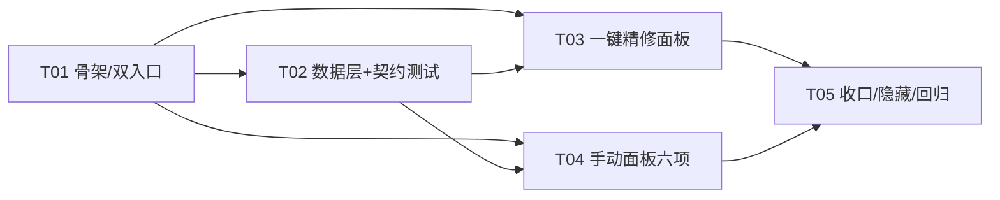
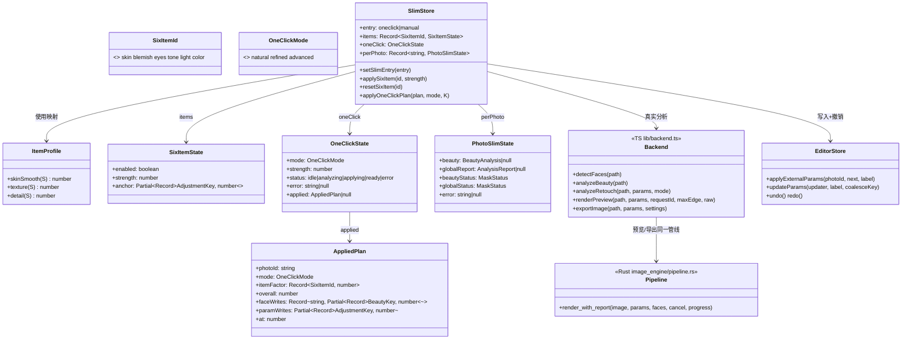
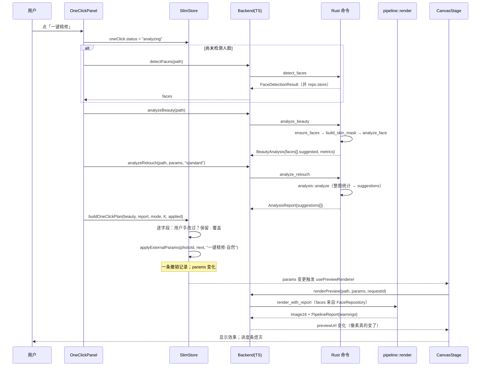

# LUMI RETOUCH 精简版审查与双入口设计

> 角色：架构师（高见远）· 任务 #1 · 仓库 `/Users/lu/Documents/lumi人像` · HEAD `452278e`（基线代码 `32efc79`）
> 本文档只做**审查与设计**，不改任何源码；所有结论均可按文中 file:line 复核。

---

## 1. 基线（本轮实测，未做 release 构建）

| 命令 | 结果 | 备注 |
|---|---|---|
| `cargo test --lib` | **478 passed / 0 failed / 3 ignored**，7.21s | 后端单元 + 内联集成测试全绿 |
| `cargo test --test beauty` | **12 passed / 0 failed / 1 ignored**，1.18s | 美肤像素级证据在这里（`--lib` 不含） |
| `pnpm test` | **8 files / 81 tests passed**，265ms | 与任务书「81 例」一致 |
| `pnpm typecheck` | **exit 0** | `tsc --noEmit` 无错误 |

**结论：基线干净，可作为回归闸门。**任何改动必须保持三条命令全绿。

---

## 2. 现有 UI 全貌（入口 → 归属 → 理由）

### 2.1 顶栏工作区 Tab（9 个，`TopBar.tsx:127-150`）

| # | Tag | 值 | 归属 | 理由 |
|---|---|---|---|---|
| 1 | 编辑 | `edit` → `Inspector` | **折叠**（并入「手动调整」） | 任务书：手动只保留六项，其余进「高级设置」 |
| 2 | 智能精修 | `smart` → `SmartPanel` | **折叠**（并入「一键精修」） | 任务书：一键精修 = 一键按钮 + 三档 + 整体强度 |
| 3 | 预设库 | `presets` | **隐藏**（菜单可回） | 任务书：只保留两个入口；LUT/曲线属「复杂高级参数」暂缓 |
| 4 | RAW | `raw` | **隐藏（菜单保留）** | 不属于暂缓清单，是老用户真实工作流；不能删 |
| 5 | 色彩 | `color` | **隐藏** | 色彩管理（ICC/软打样）是专业项，任务书要求普通人可懂 |
| 6 | 性能 | `performance` | **隐藏** | 计算后端属工程师工作台 |
| 7 | AI 人像 | `ai` | **隐藏（UI 入口移除，代码保留）** | 直接暴露 Provider / LEVEL 3 / 稠密关键点 = 禁用词重灾区 |
| 8 | 模型库 | `models` | **隐藏（UI 入口移除，代码保留）** | 暴露 SHA256 / ONNX / 归一化 = 禁用词重灾区 |
| 9 | 批量处理 | `batch` | **隐藏（菜单保留）** | 不属于暂缓清单；批量是影楼刚需，隐藏后给菜单入口 |

### 2.2 右栏 Inspector 的 20 个默认展开分组（`Inspector.tsx:119-372` + `BeautyPanel.tsx`）

| # | 分组 | 来源 | 归属 | 理由 |
|---|---|---|---|---|
| 1 | 美肤精修 | BeautyPanel `ai` | **重做**为一键精修 | 现「一键美肤」=检测+分析+写参数，正是要的入口 |
| 2 | 皮肤质感（磨皮/纹理保护/细节恢复 3 滑块） | BeautyPanel `texture` | **折叠** → 六项之① | 任务书①磨皮美肤 |
| 3 | 瑕疵修复（祛痘/祛斑/黑头 + 6 个画笔按钮） | BeautyPanel `blemish` | **折叠** → 六项之②（画笔进高级设置） | 任务书②祛痘祛斑 |
| 4 | 肤色（均匀/美白/泛红/暗沉） | BeautyPanel `tone` | **折叠** → 六项之④ | 任务书④肤色提亮 |
| 5 | 眼周（黑眼圈/眼下细纹/额头细纹/法令纹） | BeautyPanel `eyes` | **折叠** → 六项之③（只取前两项） | 任务书③眼睛美化；大眼/眼形暂缓 |
| 6 | 人物（人脸列表 + ID + 复制参数 + 显示蒙版） | BeautyPanel `people` | **折叠** → 高级设置 | 逐人脸是能力，不是首屏参数 |
| 7 | 手动蒙版 | BeautyPanel `mask` | **隐藏**（高级设置内可开） | 「蒙版算法」属暂缓/禁用词 |
| 8 | 人物蒙版（手动） | Inspector `subject-mask` | **隐藏** | 暂缓（身材/背景依赖它） |
| 9 | 身材调整 | Inspector `body` | **隐藏，代码保留** | 任务书明确暂缓「瘦身/身材」 |
| 10 | 背景处理 | Inspector `background` | **隐藏，代码保留** | 非必需，且依赖蒙版术语 |
| 11 | 面部塑形 | Inspector `reshape` | **隐藏，代码保留** | 任务书暂缓「瘦脸/大眼/鼻唇形变」；且此面板含 LEVEL 3 |
| 12 | 基础（曝光/对比度） | Inspector `basic` | **折叠** → 六项之⑤ 光影调整 | 任务书⑤光影调整 |
| 13 | 光线（高光/阴影/白色/黑色） | Inspector `light` | **折叠** → 六项之⑤ | 同上（白色/黑色色阶不进 UI） |
| 14 | 色彩（色温/色调/饱和/自然饱和 + 自动白平衡） | Inspector `color` | **折叠** → 六项之⑥ 照片色调 | 任务书⑥照片色调 |
| 15 | 细节（清晰度/锐化/颗粒/暗角） | Inspector `detail` | **隐藏**（高级设置） | 「清晰度/锐化」属进阶，非六项 |
| 16 | HSL（8 通道 × 3） | Inspector `hsl` | **隐藏，代码保留** | 任务书暂缓「复杂曲线与高级参数」 |
| 17 | 曲线（4 通道） | Inspector `curves` | **隐藏，代码保留** | 同上 |
| 18 | LUT | Inspector `lut` | **隐藏，代码保留** | 同上 |
| 19 | 人脸信息（模型版本/license/SHA256/outputs） | Inspector `faces` | **隐藏** | 禁用词直接暴露 |
| 20 | 导出设置（格式/质量） | Inspector `export` | **折叠** → 顶栏导出旁 | 保留功能，降级为弹出/折叠 |

### 2.3 其余 UI

| 位置 | 归属 | 理由 |
|---|---|---|
| `LibraryRail`（左栏图库） | **保留** | 照片预览为主的必需结构 |
| `CanvasStage`（画布 + 分屏对比 + 悬浮工具条） | **保留**，精简悬浮条 | 对比是任务书硬需求 |
| `StatusBar` | **保留**，去掉算法/毫秒文案 | 顶部信息保留「尺寸/缩放」 |
| `Toast` | **保留** | 真实反馈通道 |

---

## 3. 六项能力盘点（关键：**是否真的改变导出像素**）

### 3.1 事实链（先确立「参数 → 像素」的唯一路径）

```
slider/按钮 → EditParams（zustand, 前端）
  → renderPreview(params) / exportImage(params)      src/lib/backend.ts:74,98
  → pipeline::render_with_report(image, params, faces, cancel)   pipeline.rs:70
      ├ 人物蒙版/身材/背景（has_subject_work）
      ├ wants_beauty = skin_smooth>0 || 任一 face.enabled && beauty.is_active()   pipeline.rs:187-191
      │    └ faces 为空 → **跳过并告警**，绝不退化成全图磨皮                        pipeline.rs:194-197
      │    └ 逐脸 apply_face_retouch：瑕疵 → 平滑 → 肤色 → 眼周                     retouch/mod.rs:48-63
      ├ 塑形（has_reshape）
      └ 调色 grade::GradePlan → 清晰度 → 锐化 → 颗粒 → 暗角                         pipeline.rs:235-258
```

**两个致命前提（决定「会不会是假按钮」）：**

1. `faces` 来自 **Rust `FaceRepository`**（`render.rs:215-218`），只由 `detect_faces`（`commands/faces.rs:89` `repo.store`）或 `analyze_beauty` 的 `ensure_faces`（`beauty.rs:219-249`）写入。
   → **没跑过检测 = 美肤参数不生效**。新 UI 必须自己触发检测（现状靠 `BeautyPanel.tsx:125-140` 的 `useEffect`，新入口若不复用就会全盘变假按钮）。
2. `isNeutral(params)` 为真时预览直接复用原图、**不发后端**（`usePreviewRenderer.ts:66-69`）。
   → 「强度=0」不是 bug，是设计；但验收时要挑「强度>0」的用例。

### 3.2 逐项盘点

| 六项 | 后端能力（模块） | 参数 | 已实现？ | **改参数是否真改像素** | 证据 | 缺口 |
|---|---|---|---|---|---|---|
| ① 磨皮美肤 | 多尺度引导滤波 + 高频回注（`retouch/smoothing.rs`） | `skinSmooth` `texture` `detail`（+ 旧全局 `skinSmooth` 取 `max`，`smoothing.rs:20`） | 是 | **是**（已测） | `tests/beauty.rs:194-226` `smoothing_reduces_texture_but_retains_grain`：纹理能量 `after < before*0.95` 且 `> before*0.15` | 无。仅需注意 `texture` 越大越**保留**纹理（反向语义） |
| ② 祛痘祛斑 | 残差连通域 + 环形采样修复（`retouch/blemish.rs`） | `blemish` `spots` `blackheads` + `repairPoints` | 是 | **是**（已测） | `tests/beauty.rs:229-281`（`blemish=80` 使暗斑亮度 +0.08）、`:288-326`（痣被保护） | **`amount = blemish.max(spots)`**（`blemish.rs:45`）→ `spots` 只在大于 `blemish` 时才有意义；黑头是独立 pass（`:64`） |
| ③ 眼睛美化 | 眼下椭圆提亮 + 细纹小半径平滑（`retouch/eyes.rs`） | `darkCircles` `eyeLines` | 是 | **待实测**（代码路径确定写像素，但**无自动化断言**） | `eyes.rs:40-90` 写 `pixel.0[ch]`；`:93-137` 按 `ratio` 缩放三通道；`grep` 全仓 `tests/` **无** `dark_circles`/`eye_lines` 断言 | 需补一条合成测试（T02 验收点）。另注意 `eyeLines` 与 `foreheadLines`/`nasolabial` 共用一次平滑，`weights` 取 `max`（`eyes.rs:117`） |
| ④ 肤色提亮 | Lab 空间肤色均匀/美白/泛红/暗沉（`retouch/tone.rs`） | `toneEven` `whitening` `redness` `dullness` | 是 | **是**（`toneEven`/`whitening`/`redness` 已测；`dullness` 同一函数内、**待实测**） | `tests/beauty.rs:381-425`（Lab-a 下降、L 上升 ≤8、色度保持 ≥34%） | `whitening` 有高光保护（`tone.rs:109-111`）与色度约束（`:114-121`），不能指望「越白越亮」 |
| ⑤ 光影调整 | `grade::GradePlan`（`operations/grade.rs`） | `exposure` `contrast` `highlights` `shadows`（`whites`/`blacks` 备用） | 是 | **是**（已测） | `grade.rs:250-280` `exposure_and_whites_raise_tones` / `blacks_lower_shadows`；`pipeline.rs:358-379` | 无双向单滑块语义：方向必须由分析决定（见 §4.2） |
| ⑥ 照片色调 | `GradePlan` 白平衡分支 | `temperature` `tint` `saturation` `vibrance` | 是 | **是**（已测） | `analysis.rs:1065-1092`（冷暖相反建议）、`grade.rs:100-104`（白平衡写 RGB） | 同上 |

### 3.3 结论

**六项全部能真实改变导出像素**（① ② ⑤ ⑥ 有自动化像素断言，③ ④ 有确定的代码写入路径但缺断言）。
**最大陷阱不是引擎，而是「检测未完成 → faces 为空 → 静默跳过」**。这一点必须写进验收判据（§9），否则很容易做出一排「点了没反应」的假按钮。

---

## 4. 参数映射表

### 4.1 六项 ↔ 字段 ↔ 权重（手动调整，单滑块 S ∈ 0..100）

设计原则：**S=100 的剖面 = 引擎自身认可的安全上限**（对标 `analyze_face` 的 clamp 上限 `analyze.rs:216-232` 与既有预设 `BeautyPanel.tsx:36-40`），滑块是从 0 到该剖面的**线性缩放**，不做拍脑袋加权。

| 六项 | BeautyParams 字段公式（S=0..100） | 全局参数 | S=100 剖面 | 依据 |
|---|---|---|---|---|
| ① 磨皮美肤 | `skinSmooth=0.70S`，`texture=40+0.15S`，`detail=20+0.08S` | — | 70 / 55 / 28 | 与 `tests/beauty.rs:207-211` 的 70/60/30 同量级（纹理保护下调 5 点让效果可见，仍 >15% 保留率） |
| ② 祛痘祛斑 | `blemish=0.90S`，`spots=0.60S`，`blackheads=0.35S` | — | 90 / 60 / 35 | `tests/beauty.rs:252-260`（blemish=80 已明显修复）；刻意让 `spots ≤ blemish` 以规避 `max()` 吞并 |
| ③ 眼睛美化 | `darkCircles=0.90S`，`eyeLines=0.70S` | — | 90 / 70 | `eyeLines` 上限压到 70（`analyze_face` 只敢建议 ≤25，防眼周糊） |
| ④ 肤色提亮 | `whitening=0.50S`，`toneEven=0.65S`，`dullness=0.45S`，`redness=0.40S` | — | 50 / 65 / 45 / 40 | `analyze_face` 上限 30/45/40/40；`tone.rs:109` 高光保护决定 whitening 不敢拉满 |
| ⑤ 光影调整 | — | `exposure += dExp·k`，`contrast += dCon·k`，`highlights += dHi·k`，`shadows += dSh·k`，`k=S/100` | 见 §4.2 | `dX` 来自真实分析，`whites/blacks` **不进 UI**（术语+易翻车） |
| ⑥ 照片色调 | — | `temperature += dT·k`，`tint += dTi·k`，`saturation += dSat·k`，`vibrance += dVib·k` | 见 §4.2 | 同上 |

**明确不映射（保持 0，绝不触碰）：** `eyeShape.*` / `nose.*` / `mouth.*` / `chin.*` / `face.*`（瘦脸大眼鼻唇形变全部暂缓）、`body.*`、`background.*`、`reshpe` 手动笔触。
`foreheadLines` / `nasolabial` 在六项里**不出现**（不属「眼睛」），见 §10 待确认。

### 4.2 ⑤⑥ 的方向问题（必须说清楚，否则一定是假滑块）

`exposure` 是 -100..100 的双向参数，**没有「0..100 的强度」这种东西**。方案：

- 方向（正/负）来自**真实后端分析**：`analyzeRetouch(path, params, "standard")` → `report.suggestions[]`（`analysis.rs:506-689`，含 `exposure`/`contrast`/`highlights`/`shadows`/`temperature`/`tint`/`saturation`/`vibrance` 的 suggested 值与其他证据 reason）。
- 滑块 S 只缩放**幅度**：`写入值 = 锚点 + suggested_delta × S/100`。
  - 锚点 anchor = 该项开关打开瞬间的当前值（**不是 0**），保证关闭时能无损还原，且不破坏老项目已有的手动曝光。
  - `suggested_delta` 已由后端按 `mode.factor` 收窄（`analysis.rs:35-42`，Standard=1.0，range 如 exposure ±25、highlights -38..-4）。
- **无建议时**（`|delta| < 0.5`）：滑块禁用 + 一行诚实说明「当前光影已在合理范围，无需调整」。这是**真实结论**，不是假按钮。

### 4.3 全局安全上限（写入前 clamp，防止滑块叠加爆炸）

```
skinSmooth ≤ 85   texture ≤ 80   detail ≤ 45
blemish ≤ 95      spots ≤ 70     blackheads ≤ 45
darkCircles ≤ 95  eyeLines ≤ 70
whitening ≤ 60    toneEven ≤ 75  dullness ≤ 55   redness ≤ 50
|exposure| ≤ 30   |contrast| ≤ 30   highlights ∈ [-45, 10]   shadows ∈ [-10, 45]
|temperature| ≤ 25 |tint| ≤ 15     |saturation| ≤ 30         |vibrance| ≤ 25
```
理由：所有值必须落在 `analyze_face` 建议区间与 `EditParams::clamped`（`params.rs:962-1070`）之内，避免出现「引擎会再夹紧 → UI 显示值与实际不符」的二义。

### 4.4 多人脸与肤色差异

| 场景 | 处理 |
|---|---|
| **多人脸**（N ≥ 2） | 手动六项写入 **所有已检测且 `enabled` 的人脸**；对缺条目的人脸用 `withFaceBeauty` 自动建条目（`params.ts:608`）。面板顶部显示真实数量：「这张照片有 3 张人脸，调整会同时应用到全部」。想单独调某人 → 高级设置里的逐脸开关（`setFaceEnabled`）+ 逐脸滑块（复用现有 `updateFaceBeauty`） |
| **检测到但未建条目** | 首次写入前先跑 `analyzeBeauty`/`detectFaces`，保证 `params.faces` 与 repo 一致（现状 `setFaces` 会按 UUID 对齐，`editorStore.ts:1265-1301`） |
| **深肤色** | 不做肤色判定、不加系数：引擎已在 Lab 空间用**局部均值**做目标（`tone.rs:63-64`）并约束色度 35%..125%（`:114-121`），本身对深肤色安全。额外只做一条：分析 `notes`/`metrics.meanLuma < 0.35` 时，`whitening` 上限由 50→35（与 `analyze.rs:255` 同策） |
| **侧脸/遮挡**（`skinRatio < 0.28`） | 整项系数 ×0.7（复用 `analyze.rs:240-244` 的既有策略），并在 UI 说明「这张脸角度偏侧，效果会轻一点」 |
| **无人脸** | 六项全部禁用，显示原因（见 §6.5） |

---

## 5. 一键精修设计

### 5.1 数据来源（全部复用现有后端命令，**不新增 Rust 命令**）

| 目标 | 命令 | 现状 | 复用方式 |
|---|---|---|---|
| 逐人脸真实指标 + 建议（items ①②③④） | `analyze_beauty`（`commands/beauty.rs:74`） | 已在用（`BeautyPanel.tsx:170`） | 原样调用，取 `faces[i].suggested`（**逐脸不同**） |
| 整图光影/色调建议（items ⑤⑥） | `analyze_retouch`（`commands/analysis.rs:65`） | 已在用（`SmartPanel.tsx:68`） | 传 `mode="standard"`（见 5.3），取 `suggestions[]` |
| 写回参数 | `applyExternalParams`（`editorStore.ts:774`） | 已在用 | 一次写入 → **一条撤销记录** |

> ⚠️ 关键判定：**不要**沿用 `SmartPanel` 的 `applyRetouchSuggestions`。它的 `faceBeauty` 合并语义是「只增不减 `slot.max(suggested)`」（`image_engine/analysis.rs:873`），与「按档位缩放」冲突；而且 `analysis::beauty_suggestions` 在无皮肤模型时只给**固定保守模板**（`max 35`，`analysis.rs:372-379`），远弱于 `analyze_beauty` 的**逐脸实测建议**（`analyze.rs:216-232`）。一键精修必须走 `analyze_beauty`，否则「一键」等于摆设。

### 5.2 三档「自然 / 精致 / 高级」

| UI 档位 | 内部 `RetouchMode`（复用，不新增枚举） | 磨皮 | 祛痘 | 眼睛 | 肤色 | 光影 | 色调 |
|---|---|---|---|---|---|---|---|
| **自然**（默认） | `natural` | 0.55 | 0.50 | 0.40 | 0.55 | 0.60 | 0.50 |
| **精致** | `standard` | 0.80 | 0.75 | 0.70 | 0.80 | 0.85 | 0.75 |
| **高级** | `strong` | 1.00 | 1.00 | 1.00 | 1.00 | 1.00 | 1.00 |

- 系数含义：**「把 AI 建议做到百分之多少」**，可解释、可测。
- `light`（轻度）档在本 UI **不再出现**，枚举与后端 factor 保留（`analysis.rs:16-22`，不删代码）。
- 「高级」= 用满分析建议，**不会超过** `analyze_face` 的 clamp 上限（所以「高级」也不是塑料脸——这是引擎的安全阀，正确取舍）。

### 5.3 避免二次缩放（易错点）

`analysis::analyze` 内部已经乘过 `mode.tonal_factor()`（Natural 0.55 / Strong 1.22，`analysis.rs:35-42`）。因此：

> **一键精修调用 `analyze_retouch` 时 `mode` 固定传 `"standard"`（factor = 1.0），档位差异只由 §5.2 的 TS 系数表达。**

否则会出现 0.55×0.55 ≈ 0.30 的平方衰减，「自然档」将完全看不出变化。

### 5.4 整体强度（0..100，默认 100）

```
最终字段值 = 该字段的 AI 建议值 × 档位系数 g_item × (整体强度 K / 100)
```
- K=0 → 全 0 → 参数回到中性 → 预览自动复用原图（`usePreviewRenderer.ts:66`），即「关闭精修」。
- 不做「整份参数乘以比例」的粗暴缩放（那是 `SmartPanel.tsx:107-110` 的旧做法，会把 `0` 方向的参数也一起放大）。
- 对 `⑤⑥` 的 delta 同样乘 `g_item × K/100`，写入 `anchor + delta`。

### 5.5 「重新精修不得静默覆盖手动修改」的判定

需要的状态（**内存态，不进项目文件，不改 schema**）：

```ts
/** 一次真实写入的完整记录，用于下次比对。 */
interface AppliedPlan {
  photoId: string;
  mode: OneClickMode;              // natural | refined | advanced
  itemFactor: Record<SixItemId, number>;
  overall: number;                 // K
  faceWrites: Record<string, Partial<Record<BeautyKey, number>>>; // faceUuid → 字段 → 写入值
  paramWrites: Partial<Record<AdjustmentKey, number>>;             // 全局参数 → 写入值
  at: number;                      // Date.now()
}
```

重新精修的判定（逐字段，容差 0.5）：

| 条件 | 行为 |
|---|---|
| 当前值 ≈ `applied` 记录值 | **AI 拥有该字段**，正常覆盖 |
| 当前值 ≠ 记录值（用户手动改过） | **保留用户值，不覆盖**；在结果里列出「已保留 N 项你的手动修改」 |
| `applied == null`（首次、换照片、重启后） | **不静默覆盖**：若目标字段当前 ≠ 0 且与新值差 ≥5，先弹确认「重新精修会覆盖你已有的调整，继续吗？」 |
| 用户点「重新精修」但结果与当前完全一致 | 不写历史（`applyExternalParams` 内部 `paramsEqual` 会挡掉），提示「已经是最新效果」 |

→ 这满足任务书原话“重新精修不得静默覆盖手动修改”，且**不需要给 `EditParams` 加字段**。
可选加固（P2，需两边同步 schema）：把 `AppliedPlan` 持久化到项目；因 `EditParams` 的 `extra` 是 `#[serde(flatten)]`（`params.rs:922-924`）而 TS 侧 `clampParams` 会丢弃未知键（`project.ts:522`），**必须同时改 TS 类型 + clampParams + Rust 结构体**，属于 schema 变更 → 本轮不做。

### 5.6 一键精修的完整动作语义

| 按钮 | 行为 | 撤销标签 |
|---|---|---|
| **一键精修** | 检测（若未做）→ 双分析 → 生成 plan → 写入 | `一键精修·自然` |
| **应用/确定**（三档或强度改变后） | 用新 plan 写入（走 §5.5 保护） | `一键精修·精致` |
| **重新精修** | 重新跑真实分析（不吃缓存：`analyze_retouch` 缓存键含 params，params 变了自然失效；`analyze_beauty` 无缓存）→ 走 §5.5 写入 | `重新精修·高级` |
| **撤销** | `store.undo()`（`editorStore.ts:1161`） | — |
| **对比** | `toggleCompare()` 分屏 / 按住 `\` 看原图（`App.tsx:463-466`） | — |

---

## 6. 双入口 UI 结构

### 6.1 组件树

```
App (src/App.tsx)
├─ TopBar                        ← 品牌 / 双入口切换 / 导入·对比·撤销·重做·保存·导出 / 文件·编辑·视图菜单
├─ workspace
│  ├─ LibraryRail                ← 保留
│  ├─ CanvasStage                ← 保留（分屏对比、缩放、悬浮条精简为 对比/适应/1:1）
│  └─ 右栏（宽度 --inspector-w，只渲染当前入口）
│     ├─ entry === "oneclick" → SlimOneClickPanel
│     │   ├─ OneClickHeader       （标题 + 一句话说明 + 本地处理声明）
│     │   ├─ OneClickModeSelect   （自然 | 精致 | 高级，默认自然）
│     │   ├─ OneClickStrength     （一个整体强度滑块 0-100）
│     │   └─ OneClickActions      （一键精修 / 重新精修 / 撤销）+ 真实进度条
│     └─ entry === "manual"   → SlimManualPanel
│         ├─ ManualNoticeRow      （人脸数量 / 无人脸原因 / 加载中）
│         ├─ SixItemRow × 6       （开关 + 0-100 滑块 + 单项重置）
│         └─ AdvancedSettings（折叠，默认收起）
│             ├─ 逐人脸开关列表（N≥2 时）
│             ├─ 修复画笔（画笔/橡皮/点选，来自旧 BeautyPanel 的瑕疵画笔）
│             ├─ 旧调整清理（清除塑形/身材/背景/HSL/曲线/LUT）
│             └─ 导出设置（格式/质量）
├─ StatusBar                     ← 保留，去算法文案
└─ Toast
```

### 6.2 顶栏布局（保留哪些按钮）

| 位置 | 内容 |
|---|---|
| 左 | `LUMI RETOUCH` 品牌 |
| 中 | **双入口分段控件**：`一键精修` ｜ `手动调整`（替代原 9 个 Tab） |
| 中右 | 菜单：`文件`（导入/打开项目/保存项目/导出/**批量处理…**/**RAW 显影…**/退出）、`编辑`（撤销/重做/复制参数/粘贴参数/重置全部）、`视图`（适应窗口/实际像素/200%/对比） |
| 右 | `导入` · `对比` · `撤销` · `重做` · `保存` · `导出`（全部保留，一个不少；`重置` 收进 编辑 菜单，避免误触） |

> 批量/RAW/预设/色彩/性能的**旧面板代码不删**：菜单里点「批量处理…」→ `setWorkspace("batch")`，右栏位置换成旧面板，并显示一条「返回修图」返回键。这样老用户找得到，普通用户看不到。

### 6.3 两个入口的切换形态

- 分段控件（`segmented` 样式已存在，`app.css` 内有 `.segmented`），**不跳页、不刷状态**。
- 切换只改右栏内容；画布、图库、参数、撤销栈全部不动。
- 手动入口的滑块值 = 从当前参数**反推**（不是独立影子状态）：
  `S_item = 反解(当前字段)`：对 ①②③④ 取该组字段的 `min(字段/剖面上限)` ×100 后取整，误差 ±2 内视为一致；反解失败（例如老项目里只有 `skinSmooth=70` 而 `texture=0`）时按最近剖面显示，并把该组视为「手动编辑过」，滑块旁显示「微调过」小字。
  → 这一条很关键：**不能让两个入口各存一份数字，否则用户切换一次就丢编辑。**

### 6.4 空状态 / 无人脸 / 加载 / 失败（全部文案）

| 状态 | 文案（中文，普通人能懂） |
|---|---|
| 无照片 | 「先拖一张照片进来，或者点上面的『导入』。」 |
| 检测中（一键入口） | 「正在找照片里的人脸…」+ 真实进度（`lumi://beauty-progress`，`beauty.rs:40`） |
| 分析中（一键入口） | 「正在看这张照片需要修哪里… 一般几秒钟」 |
| 一键完成 | 「修好了，可以左右对比看看。不满意可以点『重新精修』或『撤销』。」 |
| 一键无建议 | 「这张照片状态不错，没有需要修的地方。」（应用按钮置灰） |
| 检测中（手动入口） | 「正在准备，几秒后就能调」 |
| 无人脸（手动入口） | 「这张照片里没找到人脸，手动调整用不了。换一张正面、清楚的照片试试。」（六项全部置灰） |
| 人脸过小/侧脸 | 「脸有点侧或挡到了，效果会比正面照片轻。」 |
| 分析失败 | 「刚才没成功：<原因>。点『重试』再来一次。」 |
| 渲染失败 | 「预览没出来：<原因>。参数已经保存，可以重试或导出。」 |
| 模型缺失 | 「这台电脑上缺少必要的人脸组件，请在『文件 → 检查环境』里修复。」 |

### 6.5 六项文案（开关名 + 滑块名 + 重置）

| 项 | 开关名 | 滑块旁说明 | 单项重置 |
|---|---|---|---|
| ① | 磨皮美肤 | 「让皮肤更细腻，同时尽量留住毛孔」 | 恢复默认 |
| ② | 祛痘祛斑 | 「淡掉小痘印和小斑点，痣会保留」 | 恢复默认 |
| ③ | 眼睛美化 | 「淡一点黑眼圈和眼下细纹」 | 恢复默认 |
| ④ | 肤色提亮 | 「让肤色更均匀、更透亮」 | 恢复默认 |
| ⑤ | 光影调整 | 「自动把偏暗/偏亮的地方拉回来」 | 恢复默认 |
| ⑥ | 照片色调 | 「自动纠正偏黄、偏蓝的颜色」 | 恢复默认 |

### 6.6 禁用词表（验收时逐条 grep）

**禁止出现在任何用户可见文案（含 toast / title / aria-label / 空状态）中：**

| 禁用词 | 现状出现位置（示例，需清理或随面板隐藏） |
|---|---|
| `Provider` | `AiPortraitPanel.tsx:264`、`:115` |
| `LEVEL` / `LEVEL 2` / `LEVEL 3` | `AiPortraitPanel.tsx:169,250,259,410,503,512`、`ReshapePanel.tsx:421`、`BatchWorkspace.tsx:32` |
| `关键点` / `稠密关键点` / `稠密点` | `AiPortraitPanel.tsx:55,140,250,361,500,502`、`BeautyPanel.tsx:312`、`FacePanel.tsx:115`、`ReshapePanel.tsx:380,427` |
| `置信度` / `低置信度` | `SmartPanel.tsx:20,251`、`ReshapePanel.tsx:205`、`AiPortraitPanel.tsx:360` |
| `语义分割` / `分割模型` / `ONNX` | `BeautyPanel.tsx:310`、`SubjectMaskPanel.tsx:340`、`ModelHubPanel.tsx:188` |
| `蒙版算法` / `Alpha 处理` / `羽化` | `SubjectMaskPanel.tsx:156`、`BeautyPanel.tsx:691` |
| `Tensor` | 源码注释有，UI 无（保持） |
| `SHA256` | `FacePanel.tsx:92`、`ModelHubPanel.tsx:87,276` |
| `LICENCE` / `LICENSE` / 许可证 | `FacePanel.tsx:87`、`AiPortraitPanel.tsx:280` |
| 模型名（`YuNet`、`2023mar`、`local-analysis-1`、`tract`、`ONNX Runtime`） | `FacePanel.tsx:85-88`、`SmartPanel.tsx:188`、`BeautyPanel.tsx:315` |
| 算法版本 / 结果版本 / `ms` 耗时 / `Rust` | `SmartPanel.tsx:188-190`、`Inspector.tsx:376,379`、`BeautyPanel.tsx:191,328` |
| 人脸 `ID` / 稳定 `ID` | `BeautyPanel.tsx:583,587,626` |
| 参数 `a → b` 数值清单 / `相似度 %` | `SmartPanel.tsx:249`、`BeautyPanel.tsx:587` |

**允许的替代表：** 分析 / 检测 / 精修 / 皮肤 / 瑕疵 / 眼周 / 肤色 / 光影 / 色调 / 强度 / 自然·精致·高级 / 重新精修 / 恢复默认 / 对比 / 原图。

---

## 7. 兼容性影响

| 面 | 影响 | 结论 |
|---|---|---|
| **项目文件 `.lumi`** | §5.5 采用内存 plan，**不给 `EditParams` 加字段** → 结构零变化 | **不需要迁移**。`clampParams`（`params.ts:939`）与 Rust `clamped`（`params.rs:962`）都不变 |
| 老项目里被隐藏的参数（`reshape`/`body`/`background`/`hsl`/`curves`/`lut`/`manualMask`/`repairPoints`） | 仍然参与渲染（`pipeline.rs:89-233`），但新 UI 看不到 → 用户「关不掉瘦脸」 | **必须给出口**：手动入口「高级设置 → 旧调整清理」显示「还有 2 项旧调整在生效（面部塑形、背景）」+「全部清除」 |
| 旧全局字段 `params.skinSmooth` | `smoothing.rs:20` 用 `max(beauty.skin_smooth, legacy)`，UI 隐藏后无法单独清 | 首次启用①时，若 `skinSmooth > 0` 写一次清零（进撤销栈，标签「整理旧参数」） |
| **撤销栈标签** | 新增若干标签 | `一键精修·自然/精致/高级`、`重新精修·精致`、`手动调整·磨皮美肤`、`手动调整·光影调整`、`整理旧参数`、`清除旧调整`。逐帧滑块沿用 `coalesceKey`（600ms 合并，`editorStore.ts:89`）避免一次拖动产生 80 条历史 |
| **导出** | 路径不变（`exportImage` → 同一 `render`） | 不受影响；验收要求导出图与预览一致 |
| **预览渲染** | 路径不变（`usePreviewRenderer`） | 不受影响；但新入口必须触发 `detect_faces`，否则 `faces` 为空 → 美肤静默跳过 |
| **批量工作区被隐藏** | 能力仍在（`BatchWorkspace.tsx` + `commands/batch.rs`） | 通过 文件菜单 可达；右栏临时切换 + 「返回修图」 |
| **RAW 被隐藏** | 能力仍在（`RawPanel` + `commands/raw.rs`） | 同上 |
| **`Workspace` 类型** | 保持 9 个值不变（避免动 `types.ts` 契约） | 新增的是 `slimEntry` 独立字段，不改枚举 |
| **Rust 侧** | 本轮预计 **0 行改动**（仅可选：新增 `tests/slim_items.rs` 契约测试） | 478 个 lib 测试零风险 |

---

## 8. 风险与取舍（含任务书点名的三条）

1. **隐藏后老用户找不到批量 / RAW。** 取舍：Tab 去掉，但 文件菜单 保留入口 + 首次隐藏时一条一次性提示「批量处理和 RAW 已移到『文件』菜单」。
2. **逐人脸参数在六项单滑块下的表达损失。** 一张脸一套 14 字段、N 张脸 N 套；单滑块只能表达「对所有人脸同时施加同一强度」。缓解：写入全部人脸 + 高级设置保留逐脸开关与逐脸滑块；老项目里已有的差异化值在反解时显示「微调过」而不是被静默抹平。
3. **三档与既有 natural/light/standard/strong 的语义冲突。** 「`light`(轻度)」被弃用、「`standard`(标准)→精致」、「`strong`(强化)→高级」。「高级」容易被读成「更专业」而不是「更强」，文案必须写「高级 = 力度更大，细节保留更多风险」。另：枚举不删，只做映射，避免动 `RetouchMode` 契约（`analysis.rs:16`、`analysis_retouch` 的 `mode` 参数）。
4. **⑥/⑤ 单滑块方向依赖一次分析。** 冷启动若分析失败，这两项只能禁用（诚实）。取舍：宁可禁用也不做「假装有方向」的默认偏移。
5. **「点一下像素必须变」依赖检测完成。** 首次进入可能 2–5 秒无像素变化，用户会判定「假按钮」。取舍：进入入口即后台预热检测 + 明确进度 + 全部项置灰直到 `faceStatus === "ready"`。
6. **③ 眼睛美化 / ④ dullness 缺自动化像素断言。** 现在只有代码路径证据（`eyes.rs:40-137`、`tone.rs:98-101`），`tests/` 里没有任何断言。取舍：T02 补一条合成测试，否则无法在 CI 上守住「不是假按钮」。
7. **`spots` 被 `max(blemish, spots)` 吞并**（`blemish.rs:45`）。若 ② 的映射让 `spots > blemish`，两者会互相干扰、导致「拉滑块结果不单调」。取舍：映射层强制 `spots ≤ blemish`，不改引擎。
8. **六项之下仍有不可单独关闭的子参数**（纹理保护、细节恢复、黑头、额头细纹、法令纹）。用户说「毛孔被磨没了」时只能整项关①。取舍：`texture` 随 S 上升 + 单测断言纹理保留 >15%（`tests/beauty.rs:222`）。
9. **不改 schema 的代价**：`AppliedPlan` 只活在内存，重启后「哪些是用户手改的」判定退化为一律弹确认。取舍：可接受（有确认，不静默）。
10. **工程风险**：「顺手改文案」会碰到 478 个 lib 测试与 81 个前端测试的既有契约（例如 `SmartPanel` 的文案没被测试，但 `analysis.rs` 的 `suggestions` 数量/范围被 `all_suggestions_stay_inside_documented_ranges` 锁定）。取舍：**本轮禁止改 `analysis.rs` / `analyze.rs` / `pipeline.rs` 的任何数值**。

---

## 9. 任务分解（T01–T05，按依赖排序）

> 硬约束：≤5 个任务；每个任务 ≥3 个文件；配置/入口集中放 T01；不得线性堆叠（T02–T05 均只依赖 T01，T05 额外依赖 T02–T04 的产出但可并行收尾）。

### T01 基础设施与双入口骨架（P0）

- **文件**：`src/App.tsx`、`src/components/TopBar.tsx`、`src/components/slim/featureFlags.ts`（新）、`src/state/editorStore.ts`（仅加 `slimEntry` + `setSlimEntry` 两处）、`src/styles/app.css`（追加 `.slim-*` 段）、`src/styles/tokens.css`（如需 1 个变量）
- **内容**：把 `workspace-switch`（`TopBar.tsx:127-150`）替换为双入口分段控件；`App.tsx` 右栏按 `slimEntry` 渲染新面板（新面板先用占位骨架，不写业务）；保留 `workspace !== "edit"` 时渲染旧面板的分支（供菜单回退）；文件菜单加「批量处理…」「RAW 显影…」。
- **可独立编译**：是（`pnpm typecheck` + `pnpm test` 全绿，旧面板功能不变）。
- **验收**：① 顶栏只有两个入口；② 菜单能进批量/RAW 且能返回；③ 81 个前端测试不回归。
- **风险**：低。

### T02 数据层：六项映射 / 三档系数 / plan 与保护判定（P0）

- **文件**：`src/state/slim.ts`（新：`SixItemId`、`ITEM_PROFILE`、`MODE_FACTOR`、`buildSixItemWrite()`、`buildOneClickPlan()`、`invertItemStrength()`、`mergePlanWithManualEdits()`，全部**纯函数**）、`src/state/slim.test.ts`（新）、`src-tauri/tests/slim_items.rs`（新：合成人像上断言六项剖面**确实改变像素**，含 ③ 眼睛美化与 ④ dullness 的首次断言）、`src/state/editorStore.ts`（接入 slim slice：`items`、`oneClick`、`perPhoto`、`applySixItem`、`applyOneClickPlan`）
- **内容**：把 §4.1/§4.3/§5.2/§5.4 的公式落成纯函数 + 单测（含边界：S=0/S=100/无人脸/深肤色上限）；§5.5 的覆盖判定。
- **可独立编译**：是（纯 TS + 一条 Rust 集成测试，不改 lib）。
- **验收**：
  1. `slim.test.ts` 至少 8 例：S=0 全 0；S=100 等于剖面；`spots ≤ blemish`；③ 只碰 `darkCircles/eyeLines`；⑤⑥ 无建议时返回空写入而不是 0 偏移；用户改过的字段被保留；`applied==null` 时返回「需要确认」标记；三档系数单调。
  2. `cargo test --test slim_items` 在合成图上对 ①②③④⑤⑥ 各自断言「渲染后像素 != 原像素」且在皮肤区域外不变。
- **风险**：中（③ 若实测无变化，说明 `eyes.rs` 的权重在该合成图上为 0，需要调整合成图而非改引擎——**禁止改引擎**）。

### T03 一键精修面板（P0）

- **文件**：`src/components/slim/OneClickPanel.tsx`（新）、`src/components/slim/OneClickMode.tsx`（新）、`src/components/ui/Switch.tsx`（新，无新依赖，复用现有按钮样式）、`src/components/ui/Progress.tsx`（新，接真实 `beautyProgress`/`renderProgress`）、`src/styles/app.css`（追加）
- **内容**：§5 的全部交互；真实调用 `detectFaces` → `analyzeBeauty` → `analyzeRetouch(standard)`；`applyExternalParams` 单条撤销；三档 + 整体强度；重新精修 + 确认；进度与失败文案（§6.4）；无建议态；`对比` 按钮复用 `toggleCompare`。
- **可独立编译**：是。
- **验收**（「点一下像素必须变」判据）：
  1. 导入正面人像 → 等 `faceStatus === "ready"` → 点「一键精修」→ **`renderedPreviews[photoId].url` 必须变化**，且 `renderElapsedMs > 0`（说明真的走了 Rust 管线，不是复用原图）。
  2. 三种档位各点一次，同一区域像素差异应满足 `自然 < 精致 < 高级`（用导出图做逐像素平均差比较）。
  3. 点「撤销」回到中性后，`renderedPreviews[photoId].url` 回到 `photo.previewUrl`（中性复用原图）。
  4. 手动把某一项滑块调到 0 → 点「重新精修」→ 该字段仍为 0 且提示「已保留 N 项你的手动修改」。
- **风险**：中（两段真实分析串行，需处理「分析成功一半失败」的部分成功态）。

### T04 手动调整面板 + 六项控件 + 高级设置（P0）

- **文件**：`src/components/slim/ManualPanel.tsx`（新）、`src/components/slim/SixItemRow.tsx`（新）、`src/components/slim/AdvancedSettings.tsx`（新）、`src/components/ui/Switch.tsx`（复用 T03）、`src/styles/app.css`（追加）
- **内容**：六项「开关 + 0-100 滑块 + 单项重置」（§4.1 / §6.5）；⑤⑥ 的分析锚定与禁用态；`invertItemStrength` 反解；高级设置（逐人脸开关、修复画笔复用 `brushMode`/`repairPoints`、旧调整清理、导出设置）。
- **可独立编译**：是。
- **验收**：
  1. 每项从 0 拉到 100，画布必须出现**可见且可测**的变化（导出图与上一版平均绝对差 > 0.5/255）；③ 允许幅度最小但必须 > 0。
  2. 关闭开关 → 该组字段精确归 0（⑤⑥ 回到 anchor），预览回到上一状态。
  3. 单项重置只影响该项（其余五项值不变）——用 `paramsKey` 前后对比断言。
  4. 关掉①后 `skinSmooth` 为 0 且 legacy `skinSmooth` 也为 0。
- **风险**：中高（最易出现「滑块在动但像素不动」，靠 §6.4 的置灰与预热规避）。

### T05 收口：隐藏旧入口、菜单回退、回归与验收脚本（P1）

- **文件**：`src/components/Inspector.tsx`（瘦身：只作为「高级设置」的一个可选面板，或从 `App.tsx` 卸载）、`src/components/SmartPanel.tsx` + `BeautyPanel.tsx`（挂到 `LEGACY_PANELS_ENABLED` 开关下，**不删代码**）、`src/components/TopBar.tsx`（菜单最终文案 + 一次性提示）、`src/components/StatusBar.tsx`（去算法/耗时文案）、`docs/slim-acceptance.md`（新，人工验收清单）
- **内容**：按 §2 执行隐藏/折叠；禁用词清理（§6.6 全部命中项）；菜单回退；`featureFlags.ts` 提供 `LEGACY_PANELS_ENABLED = false` 便于回滚。
- **可独立编译**：是。
- **验收**：
  1. `pnpm typecheck` + `pnpm test`（81）+ `cargo test --lib`（478）+ `cargo test --test beauty`（12）+ `cargo test --test slim_items`（新）全绿。
  2. `grep -rn "Provider\|LEVEL\|置信度\|关键点\|SHA256\|ONNX\|语义分割\|Tensor" src/components` 在**默认渲染路径**上 0 命中（允许存在于 `LEGACY_PANELS_ENABLED` 分支内的源码里，但不可达）。
  3. 项目保存 → 关闭 → 重开：参数、撤销栈重建、导出像素三条链路与改前一致（对比改前导出的 hash）。
- **风险**：中（`Inspector.tsx` 卸载后 `resetGroup`/`copyParams` 等入口消失，需确认没有别的组件依赖；已确认这些只在 Inspector 内使用）。

**依赖图**



---

## 10. 待确认（需主理人裁决，4 条）

1. **「额头细纹 / 法令纹」怎么处理？** 它们属于 `BeautyParams` 且会改像素（`eyes.rs:93-137`），但不属于六项中的任何一项。选项：(a) 完全隐藏（老项目仍生效，用户无法单独调）——推荐；(b) 并入「磨皮美肤」一起给一个系数；(c) 加进「高级设置」。**我建议 (a)**，因为 (b) 会让「磨皮」偷偷改细纹，违反直觉。
2. **「高级」档是否允许突破 `analyze_face` 的建议上限？** 现设计「高级 = 用满 AI 建议」，绝不会到 70+ 的塑料区。若产品希望「高级」明显更强，需要允许 ×1.3~1.5 超调，代价是更容易假面。**我建议不超调**（引擎现在的上限就是它自己的安全线）。
3. **批量处理 / RAW 是否保留在「文件」菜单？** 任务书要求「两个入口」，但也明确不删能力。选项：(a) 保留菜单入口（推荐）；(b) 彻底移除 UI，仅保留代码。
4. **⑤⑥ 的「0-100 强度」语义是否接受「方向由分析决定」？** 替代方案是「50 = 不变，左暗右亮」，更直观但不再是「强度」，且需要额外一次方向猜测（仍要分析）。**我建议前者**（滑块禁用时给出真实原因），但这条会直接影响文案与验收，请裁决。

---

## 附 A：类与接口（设计视图）



## 附 B：关键调用时序



## 附 C：工程师最容易踩的 6 个坑（自查清单）

1. **不触发 `detect_faces` 就调美肤** → `faces` 为空 → `pipeline.rs:194-197` 静默跳过 → 假按钮。进入入口必须先预热检测。
2. **强度=0 时以为渲染坏了** → `usePreviewRenderer.ts:66` 中性直接复用原图，这是正确行为。
3. **两次缩放**：`analyze_retouch` 的 `mode` 已含 factor，TS 再乘一次 → 自然档几乎无效果。固定传 `"standard"`。
4. **用 `applyRetouchSuggestions` 写一键** → `slot.max()` 只增不减（`analysis.rs:873`）+ 无皮肤模型时只给固定模板（`analysis.rs:372-379`）→ 效果明显偏弱。
5. **两个入口各存一份滑块状态** → 切换丢编辑。必须从 `params` 反解。
6. **顺手改引擎数值** → 撞 `all_suggestions_stay_inside_documented_ranges`（`analysis.rs:1149`）与 `tests/beauty.rs` 的纹理保留断言（`:222`）。
